# Testy hypotéz: studijní průvodce k midtermu

Zdroje: přednášky 1 až 3 H. Skalské (APSTA, UHK FIM), dvě rozhodovací schémata (B1 jeden výběr, B2 dva výběry, studentský list A5), „Testy hypotéz - příklady s řešením“, „Souhrnný přehled Rozhodování o hypotéze a funkce MsExcelu“ a Groebnerovy příklady s mobilními telefony. Příklady v kapitole 8 pocházejí z neoficiálních poznámek „Statistika pro flákače“ a jejich výsledky jsou přepočítané. Písemka je v češtině. Věty, které lze na písemce napsat, jsou v zelených rámečcích „Na písemku“.

## 0. Co písemka požaduje

Poznámky k předmětu uvádějí pět věcí, které je potřeba zvládnout u každé slovní úlohy:

1. Pojmenovat **testovaný parametr** (střední hodnota μ, rozptyl σ², podíl π), určit, zda jde o jeden výběr nebo dva, a u dvou výběrů, zda jsou závislé nebo nezávislé.
2. Zapsat **H0 a H1** slovy i symboly.
3. Navrhnout **test**, pojmenovat jeho variantu a předpoklady.
4. Vypočítat **testové kritérium (TK)** u jednovýběrových testů, F-testu a t-testu se sdruženým rozptylem.
5. Přečíst **kvantil**, například t₀.₉₇₅;₆ = 2,45, a říct, zda stačí k rozhodnutí úlohy.

Zbytek průvodce slouží těmto pěti bodům.

## 1. Značení

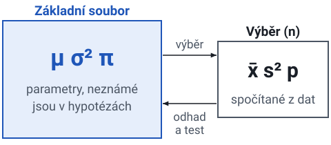

| Parametr základního souboru | Výběrový odhad | Název |
|---|---|---|
| μ | x̄ (aritmetický průměr) | střední hodnota |
| σ, σ² | s, s² | směrodatná odchylka, rozptyl |
| π | p = m/n (relativní četnost, m = počet výskytů) | pravděpodobnost výskytu jevu, podíl |
| Δ | d̄ | střední hodnota rozdílů (párový test) |
| ρ | r | korelační koeficient |
| β | b | regresní koeficient |

> Pozor
> V tomto předmětu je ==p výběrový podíl== a ==π podíl v základním souboru==. P-hodnota se jmenuje „hodnota p“ nebo „přesná hladina významnosti“ a s podílem p nemá nic společného.

Další symboly: n = rozsah výběru, df = stupně volnosti, Wα = kritický obor (oblast zamítání), V = doplňkový obor, KH = kritická hodnota, CLV = centrální limitní věta.

> Shrnutí
> - Řecká písmena (μ, σ, π) označují parametry základního souboru a píšou se do hypotéz.
> - Latinská písmena (x̄, s, p) jsou čísla spočítaná z výběru.
> - Samotné p je výběrový podíl. P-hodnota je jiný pojem.

## 2. Logika testu (přednáška 1)

==Hypotéza== je tvrzení o neznámém parametru základního souboru. Test má ==nulovou hypotézu H0== a ==alternativní hypotézu H1==. ==Testové kritérium (TK)== je funkce výběru, jejíž rozdělení se odvodí za předpokladu, že platí H0. Pokud pozorovaná hodnota padne tam, kde by za platnosti H0 byla nepravděpodobná, H0 se **zamítne**.

### Zápis H0 a H1

- H0 vždy obsahuje **„=“**. Říká, že není rozdíl, změna ani závislost. Příklady: H0: μ = 5, H0: μ₁ = μ₂, H0: π = 0,32, H0: σ₁² = σ₂².
- H1 je doplněk. Má tři tvary: μ ≠ μ₀ (**oboustranná** alternativa), μ < μ₀ (**levostranná**), μ > μ₀ (**pravostranná**).
- U jednostranné H1 logicky pokrývá H0 i druhou nerovnost. Přednáška píše H0: π = 0,32 proti H1: π > 0,32 a poznamenává, že H0 pak zahrnuje i π < 0,32.
- H1 je obvykle nové tvrzení, které někdo chce prokázat („kampaň zvýšila podíl“, „školení zkrátilo hovory“). V zadání je třeba hledat slova „větší“, „menší“, „zvýšil“, „snížil“, „liší se“, „stejný“. **„Liší se“** nebo **„změnil se“** znamená oboustrannou alternativu. **Slovo udávající směr** znamená jednostrannou.

> Na písemku
> „H0 zamítáme, přijímáme H1.“ / „H0 nezamítáme.“ Nikdy se nepíše „H0 přijímáme“. Přednáška to říká výslovně.

### Chyby při testování

| | H0 platí | H0 neplatí |
|---|---|---|
| H0 nezamítáme (TK ∈ V) | správně, P ≥ 1 − α | **chyba II. druhu**, P = β |
| H0 zamítáme (TK ∈ Wα) | **chyba I. druhu**, P ≤ α | správně, P = 1 − β = síla testu |

- ==α (hladina významnosti)== je pravděpodobnost, že se platná H0 chybně zamítne. **Volí se**, obvykle 0,05 nebo 0,01. Test je sestaven tak, aby tato pravděpodobnost nepřesáhla α.
- ==β== je pravděpodobnost, že se neplatná H0 chybně ponechá. **Nevolí se.** Dá se spočítat jen pro jednu konkrétní hodnotu alternativy, takže bývá neznámá. Proto se výsledek formuluje „H0 nezamítáme“ a ne „H0 přijímáme“.
- ==Síla testu== = 1 − β = pravděpodobnost, že se neplatná H0 zamítne.

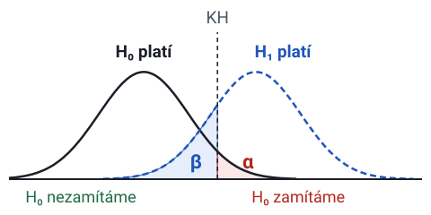

Chování β (přednáška 1, snímek 16, a simulace v přednášce 3):

- Menší α při stejném n dává **větší β**. Proto se α nevolí příliš malé.
- Větší n při stejném α dává **menší β**. V simulaci se skutečným rozdílem 3 a n = 30 se H0 nezamítla v 47 % běhů. Při n = 100 to bylo jen 3 %.
- Menší variabilita proměnné dává **menší β**. Variabilita je vlastnost dat a nedá se zvolit.

> Pozor
> U velmi velkého n se statisticky významným stane i nepatrný a prakticky bezvýznamný rozdíl. U každé úlohy je proto nutné říct, co rozdíl znamená ve skutečném problému.

### Kritický obor a kritická hodnota

- ==Kritický obor Wα== je množina hodnot TK, pro které se H0 **zamítá**. Jeho doplněk je ==V==.
- ==Kritická hodnota (KH)== je kvantil rozdělení TK, který odděluje Wα od V.
- Wα závisí na testu (tvar rozdělení TK za platnosti H0), na zvoleném **α** a na **tvaru H1**. Při oboustranné H1 připadá na každý chvost α/2. Při jednostranné H1 leží celé α v jednom chvostu.

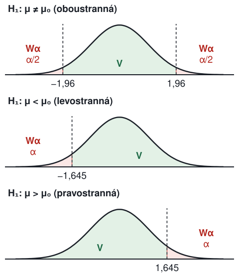

Pro testové kritérium, které je za platnosti H0 symetrické kolem 0 (U s rozdělením N(0,1), T s t-rozdělením):

| H1 | Wα | KH | p-hodnota |
|---|---|---|---|
| ≠ | \|TK\| > x₁₋α/₂ | ± x₁₋α/₂ (pro α = 0,05: ±1,96 u U) | 2·[1 − F(\|TK\|)] |
| < | TK < xα = −x₁₋α | −1,645 u U, α = 0,05 | F(TK) |
| > | TK > x₁₋α | +1,645 u U, α = 0,05 | 1 − F(TK) |

F je distribuční funkce (Φ pro N(0,1), distribuční funkce t-rozdělení pro T).

U rozdělení F a χ², která nejsou symetrická, je oboustranný kritický obor TK < xα/₂ nebo TK > x₁₋α/₂, levostranný je TK < xα a pravostranný je TK > x₁₋α.

### Dvě rozhodovací pravidla

- ==Pravidlo I==: vypočítat TK, najít KH a zamítnout H0, když **TK ∈ Wα**.
- ==Pravidlo II==: vypočítat p-hodnotu a zamítnout H0, když **p ≤ α**.

==P-hodnota== je pravděpodobnost, že za platnosti H0 vyjde TK alespoň tak extrémní, jako bylo pozorováno. Software (SPSS „Sig.“) vypisuje p. Obě pravidla vždy vedou ke stejnému rozhodnutí.

### Kvantily a čtení t₀.₉₇₅;₆ = 2,45

==Kvantil x_p== je hodnota, pro kterou platí P(X < x_p) = p. Hodnoty pod ním mají pravděpodobnost p a hodnoty nad ním pravděpodobnost 1 − p. Percentil je totéž v procentech.

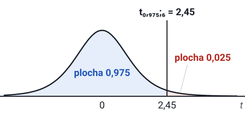

t₀,₉₇₅;₆ = 2,45 znamená: u t-rozdělení se 6 stupni volnosti mají hodnoty pod 2,45 pravděpodobnost 0,975 a hodnoty nad 2,45 pravděpodobnost 0,025. Tato hodnota je:

- kritická hodnota **oboustranného** testu při **α = 0,05** a df = 6 (obor je |t| > 2,45),
- kritická hodnota **pravostranného** testu při **α = 0,025** a df = 6,
- ze symetrie je −2,45 = t₀,₀₂₅;₆ levostranná kritická hodnota při α = 0,025.

> Pozor
> Není to kritická hodnota jednostranného testu při α = 0,05 a df = 6 (ta je t₀,₉₅;₆ = 1,943) ani pro df = 7. Když písemka zadá kvantil, je třeba zkontrolovat tři věci: **rozdělení, df a index pravděpodobnosti** oproti α a H1.

Symetrie: tα;df = −t₁₋α;df a uα = −u₁₋α. Pro F: Fα;df₁;df₂ = 1 / F₁₋α;df₂;df₁.

Čtení v Excelu: funkce INV vedou od pravděpodobnosti ke kvantilu (T.INV(0,975; 6) = 2,45) a funkce DIST od hodnoty k pravděpodobnosti (T.DIST(2,45; 6; 1) = 0,975). RT znamená pravý chvost a 2T oba chvosty.

### Postup testování (přednáška 1, snímek 20)

> Shrnutí
> - H0 obsahuje „=“. H1 je tvrzení, které se má prokázat, a směrové slovo v zadání z ní dělá jednostrannou alternativu.
> - α je riziko, že se platná H0 zamítne, a volí se předem. β je riziko, že se neplatná H0 ponechá.
> - Menší α zvětšuje β. Větší n zmenšuje β.
> - H0 se zamítá, když TK leží v kritickém oboru Wα. Stejné rozhodnutí dává pravidlo p ≤ α.
> - Kvantil se čte podle rozdělení, df a indexu pravděpodobnosti. t₀,₉₇₅ patří oboustrannému testu při α = 0,05.
> - Závěr se píše jako „H0 zamítáme“ nebo „H0 nezamítáme“ a potom slovy úlohy.

## 3. Jednovýběrové testy (přednáška 2, schéma B1)

Rozhodovací cesta ve schématu B1: je proměnná přibližně normální, nebo lze předpokládat CLV? Ano → test střední hodnoty nebo rozptylu. Ne → je to binomická proměnná (ano/ne)? Ano → test o π. Ne → jiné rozdělení nebo neparametrický test.

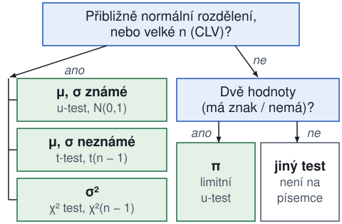

### Střední hodnota, σ známé (u-test)

H0: μ = μ₀. **U = (x̄ − μ₀) / (σ/√n)**, za platnosti H0 U ~ N(0,1). Předpoklady: normální základní soubor nebo velké n, prostý náhodný výběr, σ známé.

### Střední hodnota, σ neznámé (jednovýběrový t-test)

H0: μ = μ₀. **T = (x̄ − μ₀) / (s/√n)** = (x̄ − μ₀) / s_x̄, kde s_x̄ = s/√n je ==směrodatná chyba průměru==. Za platnosti H0 **T ~ t(n − 1)**. Předpoklady: proměnná má přibližně rozdělení N(μ, σ²), σ² je neznámé a odhaduje se pomocí s², prostý náhodný výběr. Pro n > 100 je t-rozdělení prakticky N(0,1).

Příklad z přednášky (koření): deklarováno 16 g, n = 50, x̄ = 14,9, s = 3,9, zákazníci tvrdí, že je to méně. H0: μ = 16, H1: μ < 16, α = 0,05.
t = (14,9 − 16)/(3,9/√50) = **−1,994**. KH = t₀,₀₅;₄₉ = **−1,6765**. −1,994 < −1,6765, tedy H0 se zamítá. p = F_t(−1,994) = 0,026 < 0,05.

> Na písemku
> „Deklarovaná hmotnost je vyšší než skutečná, stížnost je oprávněná.“

### Rozptyl (χ² test)

H0: σ² = σ₀². **χ² = (n − 1)s² / σ₀²**, za platnosti H0 χ² ~ χ²(n − 1). Test je **citlivý na odchylky od normality**. Oboustranný obor: χ² < χ²α/₂;n₋₁ nebo χ² > χ²₁₋α/₂;n₋₁.

### Podíl (parametr binomického rozdělení), limitní test

Dvouhodnotová proměnná (má znak / nemá). m = počet úspěchů v n nezávislých pokusech má binomické rozdělení. p = m/n odhaduje π.

H0: π = π₀. **U = (p − π₀) / √(π₀(1 − π₀)/n)**, za platnosti H0 přibližně U ~ N(0,1).

> Pozor
> Předpoklad (CLV): **n·π₀ ≥ 5 a n·(1 − π₀) ≥ 5** a π₀ není blízko 0 ani 1. Kontrola používá **π₀ z H0, ne p**. Když kontrola neprojde, použije se exaktní binomický test (není součástí písemky).

Korekce na nespojitost: přednáška odečítá 1/(2n) od |p − π₀| v čitateli. Příklad A: π₀ = 0,56, n = 500, m = 298, p = 0,596. Bez korekce u = 0,036/0,0222 = 1,62. S korekcí u = (0,036 − 0,001)/0,0222 = 1,5766. Obě hodnoty jsou pod 1,96, takže H0 se nezamítá. Oboustranné p = 2·[1 − Φ(1,5766)] = 0,1148.

Příklad B má stejná data a H1: π > 0,56. KH = u₀,₉₅ = 1,645. u = 1,58 < 1,645, nezamítá se. Jednostranné p = 1 − Φ(1,5766) = 0,0574 > 0,05. Porovnání: stejná data dávají p = 0,115 oboustranně a p = 0,057 jednostranně. **Jednostranné p je polovina oboustranného**, když výběr ukazuje ve směru H1.

> Na písemku
> „Nepodařilo se prokázat statisticky významnou změnu podílu na trhu (na hladině významnosti 0,05). Pozorovanou odchylku lze vysvětlit náhodnou chybou výběru.“

> Shrnutí
> - Střední hodnotu při známém σ testuje u-test s rozdělením N(0,1).
> - Střední hodnotu při neznámém σ testuje t-test s rozdělením t(n − 1). Pro n > 100 se blíží u-testu.
> - Rozptyl testuje χ² test s rozdělením χ²(n − 1). Vyžaduje normalitu.
> - Podíl testuje limitní u-test. Předpoklad nπ₀ ≥ 5 a n(1 − π₀) ≥ 5 se ověřuje s π₀ z H0.
> - Jednostranné p je polovina oboustranného, když výběr ukazuje ve směru H1.

## 4. Dvouvýběrové testy (přednáška 3, schéma B2)

### Závislé, nebo nezávislé výběry?

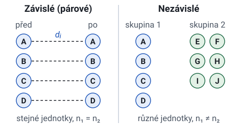

==Závislé (párové)==: stejné jednotky změřené dvakrát (před a po, první a druhé čtení) nebo jednotky spárované (stejný nákupní košík oceněný v obchodě A a v obchodě B). Každá hodnota v prvním výběru má partnera v druhém a **n₁ = n₂**.

==Nezávislé==: dvě různé skupiny jednotek (muži a ženy, zákazníci obchodu A a obchodu B, tarif Basic a tarif Business). Rozsahy se mohou lišit.

### Párový t-test

Pro každý pár se vytvoří ==rozdíl dᵢ==. Přednáška definuje dᵢ = xᵢ⁽²⁾ − xᵢ⁽¹⁾ na teoretickém snímku, zatímco řešený příklad s krevním tlakem používá D = X₁ − X₂. Obojí je v pořádku.

> Pozor
> Směr H1 musí odpovídat definici d. V řešení je nutné definici d uvést.

H0: Δ = Δ₀ (obvykle 0). d̄ = (1/n) Σ dᵢ, s_d² = (1/(n − 1)) Σ (dᵢ − d̄)².
**T = (d̄ − Δ₀) / (s_d/√n), T ~ t(n − 1).** Předpoklad: rozdíly mají přibližně rozdělení N(Δ, σ_d²). Je to **jednovýběrový t-test použitý na rozdíly**.

Příklad z přednášky (hypermarkety A a B, 100 spárovaných košíků): d̄ = 3,57, s_d = 2,99, H1: Δ > 0, α = 0,01. t = 3,57/(2,99/√100) = **11,94** > t₀,₉₉;₉₉ = **2,364**. SPSS vypsal Sig. = 0,000 (ve skutečnosti 7·10⁻²¹).

> Na písemku
> „Na 1% hladině významnosti je prokázána statisticky významně vyšší průměrná úroveň cen v hypermarketu A.“

### F-test shody rozptylů

H0: σ₁² = σ₂². **F = s₁²/s₂²**, přičemž označení se zvolí tak, aby s₁² ≥ s₂² (==větší rozptyl v čitateli==). Za platnosti H0 F ~ F(n₁ − 1, n₂ − 1) (nejdřív stupně volnosti čitatele, potom jmenovatele). Předpoklad: nezávislé výběry z normálních souborů.

S větším rozptylem nahoře záleží jen na **pravém chvostu**. Oboustranná H1 zamítá, když F > F₁₋α/₂;n₁₋₁;n₂₋₁. Pravostranná H1 zamítá, když F > F₁₋α;n₁₋₁;n₂₋₁. Když větší rozptyl nahoře není, je oboustranný obor F < Fα/₂ nebo F > F₁₋α/₂.

> Pozor
> Snímek 11 přednášky 3 píše stupně volnosti jako (n₁ − 1, n₂ − 2). Snímek 12 a příklady používají (n₁ − 1, n₂ − 1), což je správně.

Příklad z přednášky (ohřívače): s₁² = 8,354 (n₁ = 13), s₂² = 2,367 (n₂ = 15), H1: σ₁² > σ₂², α = 0,05. F = **3,53** > F₀,₉₅;₁₂;₁₄ = **2,53**. Zamítá se.

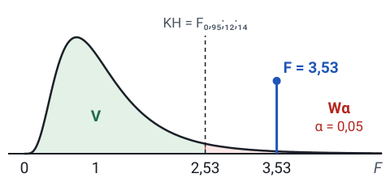

> Na písemku
> „Model 2 má statisticky významně nižší rozptyl teplot.“

F-test se v tomto předmětu používá hlavně k **výběru jedné ze dvou verzí nepárového t-testu**.

V SPSS výstup místo poměru F ukazuje ==Levenův test==. Jeho Sig. hraje stejnou roli. Když Sig. > α, rozptyly se berou jako shodné a čte se řádek „Equal variances assumed“. Když Sig. ≤ α, čte se řádek „Equal variances not assumed“.

> Pozor
> Levenovo F není poměr s₁²/s₂². Když písemka žádá kritérium F, poměr je nutné spočítat ručně.

### Nepárový t-test při shodných rozptylech

H0: μ₁ = μ₂. ==Sdružený rozptyl== s² = [(n₁ − 1)s₁² + (n₂ − 1)s₂²] / (n₁ + n₂ − 2).
**T = (x̄₁ − x̄₂) / (s·√(1/n₁ + 1/n₂))**, za platnosti H0 **T ~ t(n₁ + n₂ − 2)**.
Předpoklady: oba soubory jsou přibližně normální, nezávislé prosté náhodné výběry, σ₁² = σ₂² neznámé (F-test nezamítl).

Příklad z přednášky (autobazary A a B): n₁ = 36, x̄₁ = 169,417, s₁² = 1442,99; n₂ = 34, x̄₂ = 162,068, s₂² = 1022,6; α = 0,05.
F-test: F = 1,411 < F₀,₉₇₅;₃₅;₃₃ = 1,9886, rozptyly se berou jako shodné.
s² = (35·1442,99 + 33·1022,6)/68 = 1238,98, s = 35,20.
t = 7,349 / (35,20·√(1/36 + 1/34)) = **0,873** < t₀,₉₇₅;₆₈ = **1,995**. Nezamítá se. p = 2·T.DIST.RT(0,873; 68) = 0,386.

> Na písemku
> „Rozdíl mezi průměrnými cenami nebyl prokázán (p = 0,386).“

### Nepárový t-test při různých rozptylech (Welch)

H0: μ₁ = μ₂. **T = (x̄₁ − x̄₂) / √(s₁²/n₁ + s₂²/n₂).**
df = (s₁²/n₁ + s₂²/n₂)² / [ (s₁²/n₁)²/(n₁ − 1) + (s₂²/n₂)²/(n₂ − 1) ], **zaokrouhleno dolů** na celé číslo.

Příklad z přednášky (autobazary A a C): s₁² = 1442,99, s₃² = 636,004, obě n = 36. F = 2,269 > F₀,₉₇₅;₃₅;₃₅ = 1,961, rozptyly se tedy liší a použije se Welch. H1: μ₁ > μ₃. t = 20,823/7,599 = **2,740**, df = 60,83 → **60**, KH = t₀,₉₅;₆₀ = **1,671**. Zamítá se, p = 0,004.

### Dvouvýběrový Z-test (σ₁, σ₂ známé)

Jen ve studentském schématu A5, v přednáškách není. **Z = (x̄₁ − x̄₂ − Δ₀) / √(σ₁²/n₁ + σ₂²/n₂), Z ~ N(0,1).** Používá se, když zadání uvádí směrodatné odchylky základních souborů.

### Dva podíly (test shody podílů, shoda dvou parametrů binomického rozdělení)

Dva nezávislé výběry, p₁ = m₁/n₁, p₂ = m₂/n₂. ==Sdružený odhad== za platnosti H0: p̄ = (m₁ + m₂)/(n₁ + n₂).
H0: π₁ = π₂. **U = (p₁ − p₂) / √( p̄(1 − p̄)·(1/n₁ + 1/n₂) )**, což přednáška zapisuje také jako (p₁ − p₂)/√(p̄(1 − p̄)) · √(n₁n₂/(n₁ + n₂)). Přibližně U ~ N(0,1).
Předpoklad (CLV): **nᵢpᵢ ≥ 5 a nᵢ(1 − pᵢ) ≥ 5 u obou výběrů**. Jinak exaktní Fisherův test. Pro párová dvouhodnotová data McNemarův test. Limitní test je ekvivalentní χ² testu tabulky 2×2.

Příklad z přednášky: 54 z 231 mladých a 49 ze 173 starších lidí uvádí zhoršení. p₁ = 0,234, p₂ = 0,283, p̄ = 103/404 = 0,255. u = −0,049 / √(0,255·0,745·(1/231 + 1/173)) = **−1,13** (snímek ukazuje 1,07, protože zaokrouhlil p₂ na 0,281). |u| < 1,96, nezamítá se, p = 0,26.

> Na písemku
> „Mezi věkovými skupinami nebyl prokázán statisticky významný rozdíl v podílech.“

### Výběr testu (schéma B2)

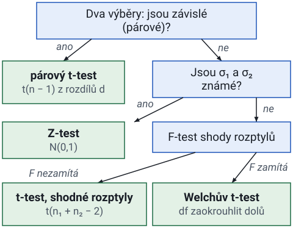

Kvantitativní proměnná, střední hodnoty:
- jeden výběr: σ známé → u-test; σ neznámé → t-test (df = n − 1)
- dva závislé výběry → párový t-test (df = n − 1)
- dva nezávislé výběry: σ₁, σ₂ známé → Z-test; neznámé → nejdřív F-test, potom t-test se sdruženým rozptylem (df = n₁ + n₂ − 2), pokud F nezamítne, a Welch, pokud zamítne
- více než dva nezávislé výběry → ANOVA (kapitola 9)

Kvantitativní proměnná, rozptyly: jeden výběr → χ²(n − 1); dva nezávislé výběry → F(n₁ − 1, n₂ − 1).

Dvouhodnotová proměnná, podíly:
- jeden výběr: nπ₀ ≥ 5 a n(1 − π₀) ≥ 5 → limitní u-test; jinak binomický test
- dva nezávislé výběry: CLV platí → limitní U test; jinak Fisherův exaktní test
- dva závislé výběry → McNemarův test

Kategoriální proměnná:
- četnosti kategorií proti předpokládaným pravděpodobnostem → χ² test dobré shody (kapitola 8)
- závislost dvou proměnných v tabulce r × c → χ² test nezávislosti (kapitola 8)

Proměnná není normální a n je malé → neparametrický test (není na písemce).

> Shrnutí
> - Nejdřív se rozhodne, zda jsou výběry závislé. Stejné nebo spárované jednotky znamenají párový t-test na rozdílech d.
> - U nezávislých výběrů s neznámými σ rozhodne F-test, kterou verzi t-testu použít. Když F nezamítne, použije se sdružený rozptyl. Když zamítne, použije se Welch.
> - F-test má větší rozptyl v čitateli a df v pořadí čitatel, jmenovatel.
> - Dva podíly se porovnávají limitním U testem se sdruženým odhadem p̄.
> - V SPSS rozhoduje o řádku výstupu Sig. Levenova testu.

## 5. Jak zapsat řešení písemkové úlohy

Tato kostra platí pro každou slovní úlohu a pokrývá vše, co se v předmětu hodnotí.

> Na písemku
> 1. **Parametr**: „Testuje se střední hodnota μ (jeden výběr, σ neznámé).“ nebo „Testují se podíly π₁ a π₂ ve dvou nezávislých výběrech.“
> 2. **Hypotézy**: „H0: μ = 540 (školení délku hovorů nezměnilo), H1: μ < 540 (školení hovory zkrátilo), levostranná alternativa.“ Vždy se uvede, o jaký parametr jde, a směr se vyjádří slovy.
> 3. **Hladina významnosti**: „α = 0,05.“
> 4. **Test a předpoklady**: „Jednovýběrový t-test. Předpoklady: přibližně normální rozdělení délky hovorů, prostý náhodný výběr, σ odhadnuto výběrovou směrodatnou odchylkou s.“
> 5. **Testové kritérium**: napsat vzorec, dosadit a uvést číslo.
> 6. **Kritický obor**: „T má při platnosti H0 t-rozdělení s df = n − 1 = 15. W₀,₀₅ = {t: t < t₀,₀₅;₁₅ = −1,753}.“ Uvede se, který kvantil je potřeba a proč má tento index.
> 7. **Rozhodnutí**: „t = −2,67 ∈ W, H0 zamítáme na hladině významnosti 0,05 (p = 0,009 < 0,05).“
> 8. **Interpretace**: „Školení statisticky významně zkrátilo průměrnou délku hovoru.“ nebo při nezamítnutí: „Statisticky významný rozdíl nebyl prokázán, pozorovaný rozdíl lze vysvětlit výběrovou chybou.“

Když písemka zadá kvantil a ptá se, zda stačí k rozhodnutí, je třeba pojmenovat **rozdělení, df a index pravděpodobnosti**, které test potřebuje, a porovnat je se zadaným. Když souhlasí, rozhodne se. Když ne, uvede se, co chybí (například „potřebuji t₀,₉₅;₁₅, zadáno je t₀,₉₇₅;₁₅, to je kritická hodnota pro oboustrannou alternativu“).

> Shrnutí
> - Řešení má osm kroků: parametr, hypotézy, α, test s předpoklady, TK, kritický obor, rozhodnutí a interpretace.
> - Hypotézy se píšou symboly i slovy úlohy.
> - U kritického oboru se uvádí, který kvantil je potřeba a proč.
> - Když zadaný kvantil nesedí na test, napíše se, který chybí.

## 6. Pasti, na které materiály předmětu upozorňují

| Častá chyba | Správně |
|---|---|
| hypotéza zapsaná s x̄, s nebo p | Hypotézy se vždy týkají **řeckého symbolu** μ, σ, π (základní soubor). |
| „H0: μ > 540“ | H0 musí obsahovat **„=“**: H0: μ = 540, H1: μ > 540. |
| jednostranná H1 s kritickou hodnotou 1,96 | Slovo udávající směr znamená jednostrannou H1 a **u₀,₉₅ = 1,645**. Oboustranná H1 používá α/2 v každém chvostu. |
| kladná kritická hodnota u levostranného testu | Kritická hodnota je **záporná** a TK musí být pod ní. |
| zdvojnásobená jednostranná p-hodnota | Jednostranná p-hodnota je **jeden chvost** a nezdvojnásobuje se. |
| menší rozptyl v čitateli F | **Větší rozptyl nahoře**, potom porovnání s F₁₋α/₂ (oboustranně) nebo F₁₋α (jednostranně). Nejdřív stupně volnosti čitatele. |
| nepárový t-test bez F-testu | **F-test předchází** nepárový t-test a rozhoduje, která verze se použije. |
| Welchovo df zaokrouhlené nahoru | Welchovo df se zaokrouhluje **dolů**. |
| párová data jako dva nezávislé výběry | Párová data (n₁ = n₂ a přirozené párování) se testují **párovým t-testem**. |
| kontrola CLV u jednoho podílu s p | U jednoho podílu se kontroluje s **π₀**, u dvou podílů s výběrovými podíly. |
| „H0 platí“ | **„H0 nezamítáme“**. Nezamítnutí znamená, že data H0 neodporují. |
| velmi malé α „pro jistotu“ | Menší α znamená **větší β**. Větší n zmenšuje β. |
| „významný rozdíl je důležitý“ | Statistická významnost **není věcná důležitost**. |
| oboustranný χ² test dobré shody | χ² test dobré shody a test nezávislosti jsou vždy **pravostranné**. Kritická hodnota je χ²₁₋α;df a v Excelu CHISQ.INV.RT(α; df). |
| df = počet sloupců − 1 u každé tabulky | U kontingenční tabulky je **df = (r − 1)(c − 1)**. Pravidlo „počet sloupců minus 1“ platí jen u tabulky se dvěma řádky. |

> Shrnutí
> - H0 obsahuje „=“ a hypotézy se píšou řeckými symboly.
> - Směrové slovo v zadání mění kritickou hodnotu z 1,96 na 1,645.
> - Závěr je vždy „H0 zamítáme“ nebo „H0 nezamítáme“, nikdy „H0 platí“.

## 7. Příklady k procvičení

Úlohy se řeší na papíře s tahákem a řešení na konci slouží ke kontrole. Potřebné kvantily: u₀,₉₅ = 1,645, u₀,₉₇₅ = 1,960, t₀,₉₅;₉ = 1,833, t₀,₉₇₅;₉ = 2,262, t₀,₉₅;₁₁ = 1,796, t₀,₉₇₅;₁₈ = 2,101, t₀,₉₉;₂₄ = 2,492, F₀,₉₅;₉;₁₁ = 2,896, F₀,₉₇₅;₉;₁₁ = 3,588, χ²₀,₀₂₅;₉ = 2,70, χ²₀,₉₇₅;₉ = 19,02.

**P1.** Automat na kávu má vydávat 5 g. V 10 náhodných kelímcích byl průměr 5,3 g a s = 0,4 g. Liší se automat od 5 g? α = 0,05. Předpokládá se normalita.

**P2.** Výrobce tvrdí, že nejvýše 10 % jeho přístrojů selže do roka. Z 200 přístrojů jich selhalo 28. Je podíl poruch vyšší, než se tvrdí? α = 0,05.

**P3.** Dvě nezávislé skupiny studentů psaly stejný test. Skupina 1: n₁ = 10, x̄₁ = 72, s₁ = 8. Skupina 2: n₂ = 12, x̄₂ = 65, s₂ = 6. Dosahuje skupina 1 v průměru vyššího skóre? α = 0,05. Předpokládá se normalita. Začít F-testem.

**P4.** U 25 pacientů se měřil cholesterol před dietou a po ní. Průměrný pokles (před − po) byl 0,30 mmol/l a s_d = 0,50. Snížila dieta cholesterol? α = 0,01.

**P5.** Ve městě A podporuje projekt 120 z 300 respondentů, ve městě B 90 z 300. Liší se podpora mezi městy? α = 0,05.

**P6.** Stroj má mít směrodatnou odchylku σ = 2,0 mm. Výběr 10 dílů má s = 2,9 mm. Liší se rozptyl od 4,0 mm²? α = 0,05. Které kvantily jsou potřeba?

**P7.** Testuje se H0: μ = 100 proti H1: μ > 100 při n = 12 a neznámém σ. List k písemce uvádí t₀,₉₇₅;₁₁ = 2,201. Vyšlo t = 2,0. Lze rozhodnout při α = 0,05? Co chybí?

**P8.** Pojmová úloha. (a) Co se stane s β, když se při stejných datech sníží α z 0,05 na 0,01? (b) Dva způsoby, jak snížit β. (c) Test s n = 10 000 zamítá H0: μ₁ = μ₂ s p = 0,001 a pozorovaný rozdíl je 0,2 % průměru. Co o tom říct?

**P9.** Výstup SPSS pro Total $ spent, muži proti ženám: Levene F = 11,262, Sig. = 0,002; řádek „Equal variances assumed“ t = 2,158, df = 48, Sig. (2-tailed) = 0,036; řádek „Equal variances not assumed“ t = 2,450, df = 44,55, Sig. (2-tailed) = 0,018. Který řádek se čte a jaký je závěr při α = 0,05?

### Řešení

**P1.** Parametr μ, jeden výběr, σ neznámé. H0: μ = 5, H1: μ ≠ 5. Jednovýběrový t-test, df = 9. t = (5,3 − 5)/(0,4/√10) = 0,3/0,1265 = 2,372. KH = ±t₀,₉₇₅;₉ = ±2,262. |2,372| > 2,262 → **H0 zamítáme** na hladině 0,05. Automat se odchyluje (přeplňuje). U jednostranné H1: μ > 5 by KH byla 1,833 a závěr by byl stejný.

**P2.** Parametr π, jeden výběr. H0: π = 0,10, H1: π > 0,10. CLV: 200·0,1 = 20 ≥ 5 a 200·0,9 = 180 ≥ 5, limitní test lze použít. p = 28/200 = 0,14. u = (0,14 − 0,10)/√(0,1·0,9/200) = 0,04/0,02121 = 1,886. KH = u₀,₉₅ = 1,645. 1,886 > 1,645 → **H0 zamítáme**. Podíl poruch je významně vyšší než 10 %. (S korekcí na nespojitost: (0,04 − 0,0025)/0,02121 = 1,768, pořád se zamítá.)

**P3.** Nejdřív F-test. H0: σ₁² = σ₂², H1: σ₁² ≠ σ₂². F = 64/36 = 1,778 (větší nahoře, df 9 a 11). KH = F₀,₉₇₅;₉;₁₁ = 3,588. 1,778 < 3,588 → rozptyly se berou jako shodné. T-test se sdruženým rozptylem. H0: μ₁ = μ₂, H1: μ₁ > μ₂. s² = (9·64 + 11·36)/20 = (576 + 396)/20 = 48,6, s = 6,971. t = (72 − 65)/(6,971·√(1/10 + 1/12)) = 7/(6,971·0,4282) = 7/2,985 = 2,345. df = 20. KH = t₀,₉₅;₂₀ = 1,725 (z tabulky t-rozdělení). 2,345 > 1,725 → **H0 zamítáme**. Skupina 1 dosahuje významně vyššího skóre.

**P4.** Párový test, parametr Δ = μ_před − μ_po. H0: Δ = 0, H1: Δ > 0. t = 0,30/(0,50/√25) = 0,30/0,10 = 3,0. df = 24. KH = t₀,₉₉;₂₄ = 2,492. 3,0 > 2,492 → **H0 zamítáme** na hladině 0,01. Dieta významně snížila cholesterol.

**P5.** Dva nezávislé podíly. H0: π₁ = π₂, H1: π₁ ≠ π₂. p₁ = 0,40, p₂ = 0,30, p̄ = 210/600 = 0,35. CLV platí (všechna n·p a n·(1 − p) jsou daleko nad 5). u = (0,40 − 0,30)/√(0,35·0,65·(2/300)) = 0,10/√(0,0015167) = 0,10/0,03894 = 2,568. KH = ±1,96. 2,568 > 1,96 → **H0 zamítáme**. Podpora se liší (p ≈ 0,010).

**P6.** Jednovýběrový test rozptylu. H0: σ² = 4, H1: σ² ≠ 4. χ² = (n − 1)s²/σ₀² = 9·8,41/4 = 18,92. df = 9. Oboustranný obor: χ² < χ²₀,₀₂₅;₉ = 2,70 nebo χ² > χ²₀,₉₇₅;₉ = 19,02. 18,92 je těsně pod 19,02 → **H0 nezamítáme**. Odchylka není významná při α = 0,05 (při α = 0,10, kde je kvantil 16,92, by významná byla).

**P7.** Potřebná je pravostranná kritická hodnota t₀,₉₅;₁₁ = 1,796. Zadané t₀,₉₇₅;₁₁ = 2,201 je oboustranná hodnota při α = 0,05 (nebo jednostranná při α = 0,025). Samotná dovoluje říct jen toto: protože 2,0 < 2,201, je jednostranné p větší než 0,025. Z toho nevyplývá, zda p ≤ 0,05. Protože t₀,₉₅;₁₁ = 1,796 < 2,0, H0 se při α = 0,05 zamítá. Na písemce se píše, který kvantil je potřeba a proč.

**P8.** (a) β roste. Menší α zmenšuje kritický obor, takže se neplatná H0 ponechává častěji. (b) Zvětšit n nebo snížit variabilitu měření (lepší plán, homogennější jednotky). Zvolit větší α také snižuje β, ale zvyšuje riziko chyby I. druhu. (c) Rozdíl je statisticky významný, protože n je obrovské, ale rozdíl 0,2 % je prakticky zanedbatelný. Uvádí se p-hodnota i velikost rozdílu a říká se, že statistická významnost neznamená věcnou důležitost.

**P9.** Levene Sig. = 0,002 < 0,05, rozptyly se tedy liší a čte se „Equal variances not assumed“: t = 2,450, df = 44,55, p = 0,018 < 0,05. H0 o shodě průměrných výdajů se zamítá. Muži v průměru utrácejí významně více (rozdíl průměrů 38,38 USD). Kdyby alternativa byla jednostranná v pozorovaném směru, bylo by p = 0,009.

> Shrnutí
> | Úloha | Test | Rozhodnutí |
> |---|---|---|
> | P1 | jednovýběrový t-test, oboustranný | zamítáme (2,372 > 2,262) |
> | P2 | limitní test o podílu, pravostranný | zamítáme (1,886 > 1,645) |
> | P3 | F-test, potom t-test se sdruženým rozptylem, pravostranný | zamítáme (2,345 > 1,725) |
> | P4 | párový t-test, pravostranný | zamítáme (3,0 > 2,492) |
> | P5 | test shody dvou podílů, oboustranný | zamítáme (2,568 > 1,96) |
> | P6 | χ² test rozptylu, oboustranný | nezamítáme (18,92 < 19,02) |
> | P7 | jednovýběrový t-test, pravostranný | zadaný kvantil nestačí, s t₀,₉₅;₁₁ = 1,796 zamítáme |
> | P8 | pojmová úloha | |
> | P9 | Welchův t-test podle Levenova testu | zamítáme (p = 0,018) |

## 8. χ² testy dobré shody a nezávislosti (nejsou v midtermu)

Oba testy porovnávají ==pozorované četnosti== s ==teoretickými četnostmi==, které by vyšly za platnosti H0. Testové kritérium je v obou případech χ² = Σ (pozorovaná − teoretická)² / teoretická. Velké χ² znamená velký rozdíl mezi daty a H0, proto je kritický obor **jen vpravo**: Wα = {χ² > χ²₁₋α;df}.

> Pozor
> Předpoklad: **všechny teoretické četnosti jsou alespoň 5**. Když některá vyjde menší, sousední kategorie se sloučí.

### Test dobré shody

Jedna kategoriální proměnná s k kategoriemi. Zadání určí pravděpodobnosti π₁, …, πₖ, které kategoriím přiřazuje předpoklad (marketingový plán, rovnoměrné rozdělení, férová kostka).

- H0: rozdělení odpovídá předpokladu, tedy P(kategorie i) = πᵢ pro všechna i.
- H1: H0 neplatí, alespoň jedna pravděpodobnost je jiná.
- ==Teoretická četnost==: **nᵢᵀ = n·πᵢ**, kde n je součet pozorovaných četností nᵢ.
- **χ² = Σ (nᵢ − nᵢᵀ)² / nᵢᵀ**, za platnosti H0 přibližně **χ²(k − 1)**.
- Když se parametry předpokládaného rozdělení odhadují z dat (například průměr u normálního rozdělení), df se zmenší o počet odhadnutých parametrů.

Příklad (kostka): 30 hodů, ověřuje se, zda je kostka férová. H0: πᵢ = 1/6 pro všechna čísla, α = 0,05.

| Číslo | 1 | 2 | 3 | 4 | 5 | 6 |
|---|---|---|---|---|---|---|
| nᵢ | 4 | 6 | 7 | 2 | 5 | 6 |
| nᵢᵀ = 30·1/6 | 5 | 5 | 5 | 5 | 5 | 5 |
| (nᵢ − nᵢᵀ)²/nᵢᵀ | 0,2 | 0,2 | 0,8 | 1,8 | 0 | 0,2 |

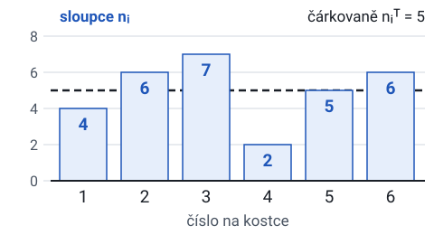

χ² = 3,2, df = 6 − 1 = 5, KH = χ²₀,₉₅;₅ = 11,07. 3,2 < 11,07, **H0 nezamítáme** (p = 0,67).

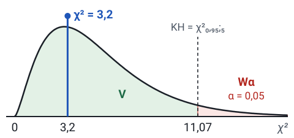

> Na písemku
> „Na hladině 0,05 nebylo prokázáno, že kostka není férová. Odchylky od 5 hodů na číslo lze vysvětlit náhodou.“

### Test nezávislosti v kontingenční tabulce

Dvě kategoriální proměnné zjištěné na jednom výběru. Tabulka má r řádků a c sloupců s pozorovanými četnostmi nᵢⱼ, řádkovými součty nᵢ., sloupcovými součty n.ⱼ a celkovým počtem n.

- H0: proměnné jsou nezávislé.
- H1: proměnné jsou závislé.
- ==Teoretická četnost==: **nᵢⱼᵀ = nᵢ.·n.ⱼ / n** (řádkový součet krát sloupcový součet děleno celkovým počtem). Za nezávislosti má každý řádek stejné rozložení do sloupců jako celá tabulka.
- **χ² = Σᵢ Σⱼ (nᵢⱼ − nᵢⱼᵀ)² / nᵢⱼᵀ**, za platnosti H0 přibližně **χ²((r − 1)(c − 1))**.
- Tabulka 2 × 2 dává stejné rozhodnutí jako limitní test shody dvou podílů. Platí χ² = u².

Příklad (jakost a směna): závisí jakost výrobků na směně? α = 0,05. V buňkách jsou pozorované četnosti a v závorce teoretické.

| Směna | Jakost I | Jakost II | Zmetky | Celkem |
|---|---|---|---|---|
| dopolední | 170 (163,37) | 250 (272,28) | 80 (64,36) | 500 |
| odpolední | 160 (166,63) | 300 (277,72) | 50 (65,64) | 510 |
| Celkem | 330 | 550 | 130 | 1010 |

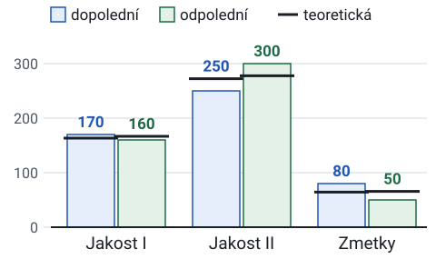

Například n₁₁ᵀ = 500·330/1010 = 163,37. Příspěvky buněk: 0,269 + 1,823 + 3,803 + 0,264 + 1,787 + 3,728 = 11,67. df = (2 − 1)(3 − 1) = 2, KH = χ²₀,₉₅;₂ = 5,991. 11,67 > 5,991, **H0 zamítáme** (p = 0,003).

> Na písemku
> „Jakost výrobků statisticky významně závisí na směně. Dopolední směna vyrábí víc zmetků, než by odpovídalo nezávislosti (80 proti 64,4).“

### Příklady k procvičení

Potřebné kvantily: χ²₀,₉₅;₁ = 3,841, χ²₀,₉₅;₂ = 5,991, χ²₀,₉₅;₃ = 7,815. Ve všech úlohách je α = 0,05.

**P10.** Plán počítal s prodejem záznamu koncertu v poměru 50 % CD, 30 % DVD a 20 % kazety. Za měsíc se prodalo 2552 CD, 923 DVD a 384 kazet. Odpovídá prodej plánu?

**P11.** V průzkumu bylo 25 lidí malé postavy, 53 střední a 42 velké. Jsou všechny tři velikosti zastoupené rovnoměrně?

**P12.** Plán počítal s prodejem praček v poměru 40 % USA, 30 % Evropa, 20 % Asie a 10 % zbytek světa. Prodalo se 4210, 3180, 1020 a 1020 kusů. Odpovídá prodej plánu?

**P13.** Na otázku odpovědělo ano 25 mužů a 35 žen, ne 40 mužů a 40 žen. Závisí odpověď na pohlaví?

**P14.** Ze 40 velkých firem exportuje 15, ze 75 středních 25 a z 60 malých 30. Závisí export na velikosti firmy?

### Řešení (χ² testy)

**P10.** Dobrá shoda, k = 3, n = 3859. nᵢᵀ = 1929,5; 1157,7; 771,8. χ² = 200,83 + 47,58 + 194,86 = 443,27. df = 2, KH = 5,991. **H0 zamítáme**. Prodej neodpovídá plánu: CD se prodalo víc a kazet méně, než plán čekal.

**P11.** Dobrá shoda, H0: πᵢ = 1/3. n = 120, nᵢᵀ = 40. χ² = 225/40 + 169/40 + 4/40 = 9,95. df = 2, KH = 5,991. **H0 zamítáme** (p = 0,007). Velikosti nejsou zastoupené rovnoměrně, nejvíc je lidí střední postavy.

**P12.** Dobrá shoda, k = 4, n = 9430. nᵢᵀ = 3772; 2829; 1886; 943. χ² = 50,86 + 43,55 + 397,64 + 6,29 = 498,34. df = 3, KH = 7,815. **H0 zamítáme**. Největší odchylka je v Asii, kde se prodalo 1020 praček místo očekávaných 1886.

**P13.** Tabulka 2 × 2, řádkové součty 65 a 75, sloupcové 60 a 80, n = 140. nᵢⱼᵀ = 27,86; 37,14; 32,14; 42,86. χ² = 0,957. df = 1, KH = 3,841. **H0 nezamítáme** (p = 0,33). Závislost odpovědi na pohlaví nebyla prokázána. Limitní test shody podílů dá u = (25/65 − 35/75)/√(0,4286·0,5714·(1/65 + 1/75)) = −0,978 a u² = 0,957.

**P14.** Tabulka 3 × 2 (velikost × exportuje ano/ne). Neexportuje 25, 50 a 30 firem. Sloupcové součty 70 a 105, n = 175. nᵢⱼᵀ: velké 16 a 24, střední 30 a 45, malé 24 a 36. χ² = 0,063 + 0,042 + 0,833 + 0,556 + 1,5 + 1 = 3,99. df = (3 − 1)(2 − 1) = 2, KH = 5,991. **H0 nezamítáme** (p = 0,14). Závislost exportu na velikosti firmy nebyla prokázána.

> Shrnutí
> - Test dobré shody porovnává jednu proměnnou s předpokladem a má df = k − 1. Teoretická četnost je n·πᵢ.
> - Test nezávislosti porovnává tabulku r × c s nezávislostí a má df = (r − 1)(c − 1). Teoretická četnost je řádkový součet krát sloupcový součet děleno n.
> - Oba testy jsou pravostranné a potřebují teoretické četnosti alespoň 5.
>
> | Úloha | Test | df | Rozhodnutí |
> |---|---|---|---|
> | P10 | dobrá shoda | 2 | zamítáme (443,27 > 5,991) |
> | P11 | dobrá shoda | 2 | zamítáme (9,95 > 5,991) |
> | P12 | dobrá shoda | 3 | zamítáme (498,34 > 7,815) |
> | P13 | nezávislost 2 × 2 | 1 | nezamítáme (0,957 < 3,841) |
> | P14 | nezávislost 3 × 2 | 2 | nezamítáme (3,99 < 5,991) |

## 9. Analýza rozptylu (není v midtermu)

ANOVA pro jeden faktor testuje H0: μ₁ = μ₂ = … = μᵣ pomocí F = MSTR/MSE a df (r − 1, n − r).
