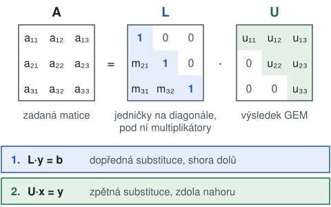
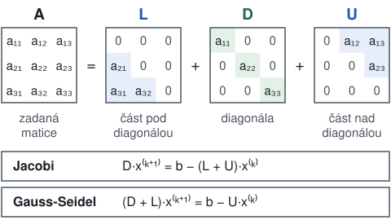
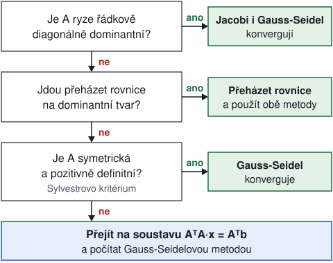

# Chyby a soustavy rovnic: studijní průvodce k zápočtu z NUMA

Zdroje: poznámky ze cvičení, přednáška P. Pražáka „Reprezentace čísel, O chybách a nepřesných číslech“ (numa_01.pdf), listy ze cvičení k LU rozkladu a k iteračním metodám (cvLU_rozklad.pdf, cvITER_SLAR.pdf), řešený příklad MOJE_CHYBA.pdf, kapitola IV „Nejistoty měření a zpracování výsledků“, norma IEEE 754, soubory .m ze cvičení 1 až 4 a dokumentace Matlabu od MathWorks. Kód pro Matlab v průvodci nebyl spuštěný. Výsledky na kontrolu jsou přepočítané v Pythonu, u přímých metod přesně ve zlomcích. V materiálech ke cvičení nejsou tyto věci, které průvodce přebírá ze standardní učebnicové látky: vlastní a singulární čísla, podmínka ρ(B) < 1, nerovnost s cond(A), hrubé pravidlo o ztrátě platných číslic, mez eps/2 a převod čísla do dvojkové soustavy. Kroky a věty, které se píšou na zápočtu, jsou v zelených rámečcích „Na písemku“.

## 0. Co zápočet požaduje

Na zápočtu se matice připraví na papíře, výsledek se spočítá v Matlabu a postup se popíše stejně jako v poznámkách ze cvičení. Poznámky mají u LU rozkladu a u Gauss-Seidelovy metody připsané, co se má v testu rozepsat.

> Na písemku
> 1. Zadání: matice A a pravá strana b.
> 2. Úprava matice na papíře a její důvod, například multiplikátory, prohození řádků nebo kontrola podmínky konvergence.
> 3. Název metody a její vzorce rozepsané pro konkrétní matici.
> 4. Příkazy nebo funkce z Matlabu, které spočítaly výsledek.
> 5. Výsledek. U iteračních metod také počáteční vektor, tolerance a počet iterací.

Kapitoly jsou seřazené tak, jak na sebe navazují. U každé kapitoly je nejrychlejší přečíst postup na papír, ručně přepočítat příklad z poznámek a pak spočítat cvičení a výsledek ověřit v Matlabu.

| Kapitola | Soubory od vyučujícího |
|---|---|
| 1. Matlab | numa_01.pdf (str. 42 až 48), cv01_intro/matlab/cviceni_01a.m |
| 2. GEM a pivotace | cv02_gauss/matlab: cviceni_02.m, NaseEliminace.m, NaseEliminaceCastecna.m, NaseZpet.m |
| 3. a 4. LU rozklad a Cholesky | cvLU_rozklad.pdf, cv03_LU/matlab/LU: cviceni_03.m, MOJELUDNES.m, solve_LU.m, inverzni.m, determinant.m, a cv03_LU/matlab/cholesky.m |
| 5. Normy a podmíněnost | cv03_LU/matlab/cond.txt, cviceni_02.m (příklad 3) |
| 6. Iterační metody | cvITER_SLAR.pdf, cv04_iterSLAR/matlab: cviceni_04.m, Ritz.m, NaseJacobi.m, NaseGaussSeidel.m |
| 7. a 8. Chyby a reprezentace čísel | numa_01.pdf, MOJE_CHYBA.pdf, kapitola IV.pdf, ieee754.pdf |

Funkce ze cvičení (soubory .m) musí ležet v aktuální složce Matlabu (Current Folder), jinak je Matlab nenajde.

## 1. Matlab minimum

Na zápočet stačí umět zadat matici, vyřešit soustavu a ověřit ruční výpočet.

```
A = [1 -2 3; 6 -13 18; 4 -10 14];
b = [1; 2; 3];
x = A\b
A*x - b
format long
x
format short
A'
eye(3)
A(2,3)
A(2,:)
A(:,1)
```

- Mezera odděluje prvky v řádku a středník začíná nový řádek.
- `b = [1; 2; 3]` je sloupcový vektor. Pravá strana soustavy musí být sloupec.
- `x = A\b` řeší soustavu Ax = b. Inverzi přitom nepočítá.
- `A*x - b` ověří řešení. Má vyjít nula nebo čísla řádu 10⁻¹⁵, což je zaokrouhlovací chyba.
- Řádek se středníkem na konci se nevypíše. Řádek bez středníku vypíše výsledek.
- `format long` zobrazí 15 desetinných míst a `format short` vrátí 4.
- `A'` je transponovaná matice a `eye(3)` je jednotková matice řádu 3, v poznámkách značená E.
- `A(2,3)` je prvek ve 2. řádku a 3. sloupci, `A(2,:)` celý 2. řádek a `A(:,1)` celý 1. sloupec.

V Matlabu se píše desetinná tečka (`0.5`), na papíře desetinná čárka (0,5). Matice jsou v průvodci i v textu zapsané po řádcích se středníkem mezi řádky, například (1 2; 3 4).

> Shrnutí
> - Matice se zadává po řádcích a středník začíná nový řádek.
> - `A\b` řeší soustavu a `A*x - b` kontroluje výsledek.
> - Středník na konci řádku potlačí výpis.

## 2. GEM, pivotace a zpětná substituce

==Gaussova eliminační metoda (GEM)== převede matici soustavy na horní trojúhelníkovou matici U. Soustava s U se pak vyřeší ==zpětnou substitucí== odspodu nahoru.

### Postup na papír

> Na písemku
> 1. V kroku k vynulovat prvky pod diagonálou v k-tém sloupci.
> 2. Za pivot vzít prvek aₖₖ na diagonále.
> 3. Pro každý řádek i pod pivotem spočítat multiplikátor mᵢₖ = aᵢₖ / aₖₖ.
> 4. Nový řádek i = řádek i − mᵢₖ · řádek k. Stejně upravit pravou stranu b.
> 5. Po posledním kroku spočítat zpětnou substitucí nejdřív xₙ, pak xₙ₋₁ a tak dál nahoru.

Tímto zápisem je spočítaný příklad v poznámkách (str. 5 a 6) pro A = (1 −2 3; 6 −13 18; 4 −10 14):

```
KROK 1: nulování 1. sloupce, PIVOT = 1
  m21 = 6/1 = 6       2. řádek − 6 · 1. řádek = (0, −1, 0)
  m31 = 4/1 = 4       3. řádek − 4 · 1. řádek = (0, −2, 2)
KROK 2: nulování 2. sloupce, PIVOT = −1
  m32 = −2/(−1) = 2   3. řádek − 2 · 2. řádek = (0, 0, 2)

U = (1 −2 3; 0 −1 0; 0 0 2)
```

Zpětná substituce postupně pro i = n, n − 1, …, 1:

**xᵢ = (bᵢ − Σ uᵢⱼ·xⱼ) / uᵢᵢ**, kde součet jde přes j = i + 1, …, n.

### Pivotace

==Částečná pivotace== vybere v každém kroku za pivot prvek s největší absolutní hodnotou v nulovaném sloupci (na diagonále a pod ní) a prohodí řádky. Prohodí se i prvky pravé strany b. Nulový pivot by eliminaci zastavil. Malý pivot dá velký multiplikátor a ten zvětší zaokrouhlovací chyby.

### Vliv zaokrouhlovacích chyb

Soustava 10⁻¹⁷·x₁ + x₂ = 1, x₁ + x₂ = 2 má řešení velmi blízko (1; 1). Bez pivotace je multiplikátor 10¹⁷ a výpočet vrátí (0; 1). S pivotací se nejdřív prohodí řádky a vyjde (1; 1).

```
m = 1/1e-17;
u22 = 1 - m*1;
y2 = 2 - m*1;
x2 = y2/u22
x1 = (1 - x2)/1e-17
A = [1e-17 1; 1 1];
b = [1; 2];
A\b
```

- Prvních pět řádků je GEM bez pivotace rozepsaná ručně. Hodnota 1 − 10¹⁷ se v počítači zaokrouhlí na −10¹⁷, a proto vyjde x1 = 0.
- `A\b` počítá s pivotací a vrátí správné (1; 1).

Přednáška numa_01.pdf (str. 19 až 21) ukazuje totéž na soustavě 47x + 28y = 19, 89x + 53y = 36. Přesné řešení je (1; −1). Při počítání se 3 platnými číslicemi vyjde (−0,191; 1). Další ukázky jsou v cviceni_02.m (příklady 4 a 6).

### Funkce ze cvičení

```
[U, y] = NaseEliminace(A, b);
x = NaseZpet(U, y)
[U, y] = NaseEliminaceCastecna(A, b);
x = NaseZpet(U, y)
```

- `NaseEliminace` je GEM bez pivotace. Vrátí horní trojúhelníkovou U a upravenou pravou stranu y.
- `NaseEliminaceCastecna` je GEM s částečnou pivotací. U singulární matice skončí chybou „Matice je singularni“.
- `NaseZpet` je zpětná substituce.

> Pozor
> Soubor mojepivotace.m z roku 2024 má dvě chyby. Pozici pivota přepočítá jako `pozice-k+1` místo `pozice+k-1` a multiplikátor dělí absolutní hodnotou pivota. Pro matici z poznámek a b = (1; 2; 3) vrátí (5,5; 4; 1,17) místo správného (−1,5; 4; 3,5). Spolehlivá je funkce `NaseEliminaceCastecna`.

### Cvičení

Vyřešit GEM soustavu A = (2 1 1; 4 3 3; 8 7 9), b = (4; 10; 24). Na kontrolu: m₂₁ = 2, m₃₁ = 4, m₃₂ = 3, U = (2 1 1; 0 1 1; 0 0 2), upravená pravá strana (4; 2; 2) a x = (1; 1; 1).

> Shrnutí
> - GEM nuluje prvky pod diagonálou po sloupcích. Multiplikátor je nulovaný prvek dělený pivotem.
> - Zpětná substituce počítá neznámé od poslední k první.
> - Částečná pivotace bere za pivot prvek sloupce s největší absolutní hodnotou. Chrání tak před nulovým a malým pivotem.
> - `A\b` pivotuje sám.

## 3. LU rozklad

==LU rozklad== zapíše matici jako A = L·U. U je výsledek GEM. L má na diagonále jedničky a pod ní multiplikátory z GEM. Rozklad se spočítá jednou a pak se s ním řeší libovolně mnoho pravých stran.

- A = L·U
- L·y = b se řeší dopřednou substitucí (shora dolů) a U·x = y zpětnou substitucí (zdola nahoru).
- det A = det L · det U = u₁₁·u₂₂·…·uₙₙ, protože det L = 1.



### Postup na papír

> Na písemku
> 1. Napsat, že se použije LU rozklad.
> 2. Provést GEM bez prohazování řádků a zapsat multiplikátory jako v kapitole 2.
> 3. Zapsat U a L. Pro matici z poznámek je L = (1 0 0; 6 1 0; 4 2 1) a U = (1 −2 3; 0 −1 0; 0 0 2).
> 4. Soustava Ax = b: vyřešit Ly = b dopřednou substitucí a pak Ux = y zpětnou substitucí.
> 5. Více pravých stran AX = B: zopakovat krok 4 pro každý sloupec B. L a U se nemění.
> 6. Inverzní matice: vyřešit A·xᵢ = eᵢ pro každý sloupec eᵢ jednotkové matice. Vektory xᵢ jsou sloupce A⁻¹.
> 7. Determinant: vynásobit prvky na diagonále U. Pro matici z poznámek je det A = 1 · (−1) · 2 = −2.

### V Matlabu

```
A = [1 -2 3; 6 -13 18; 4 -10 14];
L = [1 0 0; 6 1 0; 4 2 1];
U = [1 -2 3; 0 -1 0; 0 0 2];
L*U - A
b = [1; 2; 3];
y = L\b
x = U\y
X = U\(L\eye(3))
inv(A)
prod(diag(U))
det(A)
```

- `L*U - A` musí vyjít nulová matice. Tím se ověří ručně spočítané L a U.
- `L\b` a `U\y` řeší soustavy s trojúhelníkovou maticí, tedy dopřednou a zpětnou substituci.
- `U\(L\eye(3))` vyřeší soustavy pro e₁, e₂ a e₃ najednou. Výsledek je A⁻¹ a má se shodovat s `inv(A)`.
- `prod(diag(U))` vynásobí prvky na diagonále U. Musí vyjít stejně jako `det(A)`.

Na cvičení vznikly funkce, které počítají totéž krok po kroku (cv03_LU/matlab/LU):

```
[L, U] = MOJELUDNES(A);
x = solve_LU(L, U, b)
X = inverzni(L, U)
D = determinant(U)
```

- `MOJELUDNES` (stejně jako starší `NaseLU`) spočítá L a U bez pivotace, tedy stejně jako ruční výpočet.
- `solve_LU` vyřeší Ly = b funkcí `fwsub` a pak Ux = y funkcí `backsub`. Soubory fwsub.m a backsub.m musí být ve stejné složce.
- `inverzni` zavolá `solve_LU` pro každý sloupec jednotkové matice.
- `determinant` vynásobí prvky na diagonále U.

> Pozor
> `[L, U, P] = lu(A)` v Matlabu prohazuje řádky a platí P·A = L·U. Jeho L a U se proto liší od ručního výpočtu bez pivotace. Pro matici z poznámek vyjde P = (0 1 0; 0 0 1; 1 0 0), L = (1 0 0; 0,6667 1 0; 0,1667 −0,125 1) a U = (6 −13 18; 0 −1,3333 2; 0 0 0,25). Řešení, inverze i determinant vyjdou stejně. Ruční L a U se proto ověřují přes `L*U - A`, ne porovnáním s `lu(A)`. U determinantu z pivotovaného rozkladu se násobí (−1) za každé prohození řádků. Tady byla dvě prohození, takže det A = 6 · (−4/3) · (1/4) = −2.

List cvLU_rozklad.pdf ukazuje oba výsledky vedle sebe. Pro A = (3 4 −5; 6 −3 4; 8 9 −2) dá Matlab permutovanou L = (0,375 −0,064 1; 0,750 1 0; 1 0 0) a U = (8 9 −2; 0 −9,75 5,5; 0 0 −3,897). Ručně bez pivotace vyjde L = (1 0 0; 2 1 0; 2,667 0,152 1) a U = (3 4 −5; 0 −11 14; 0 0 9,212).

### Cvičení

1. Dokončit inverzi z poznámek (str. 6). Na kontrolu: pro e₁ je y = (1; −6; 8) a x = (1; 6; 4), pro e₂ je y = (0; 1; −2) a x = (1; −1; −1), pro e₃ je y = (0; 0; 1) a x = (−1,5; 0; 0,5). Tedy A⁻¹ = (1 1 −1,5; 6 −1 0; 4 −1 0,5).
2. Inverze matice z poznámek (str. 1), A = (1 2 6; 2 5 15; 6 15 46). Na kontrolu: L = (1 0 0; 2 1 0; 6 3 1), U = (1 2 6; 0 1 3; 0 0 1), det A = 1 a A⁻¹ = (5 −2 0; −2 10 −3; 0 −3 1). Stejný příklad je na listu cvLU_rozklad.pdf.
3. Soustava A = (2 1 1; 4 3 3; 8 7 9), b = (4; 10; 24) přes LU. Na kontrolu: L = (1 0 0; 2 1 0; 4 3 1), y = (4; 2; 2), x = (1; 1; 1), det A = 4 a A⁻¹ = (1,5 −0,5 0; −3 2,5 −0,5; 1 −1,5 0,5).
4. Maticová rovnice AX = B z listu cvLU_rozklad.pdf: A = (3 4 −5; 6 −3 4; 8 9 −2), B = (1 3; 9 5; 9 4). Vyřešit dvě soustavy Ax₁ = b₁ a Ax₂ = b₂ se stejnými L a U. Na kontrolu: X = (1,164 0,891; 0,092 −0,441; 0,572 −0,418) a det A = −304.

> Shrnutí
> - A = L·U. U je výsledek GEM, L má jedničky na diagonále a multiplikátory pod ní.
> - Soustava se řeší dvěma substitucemi: Ly = b shora dolů a Ux = y zdola nahoru.
> - Inverze jsou soustavy s pravými stranami e₁ až eₙ.
> - det A je součin prvků na diagonále U.
> - Funkce `lu` prohazuje řádky, takže její L a U se liší od ručního výpočtu bez pivotace.

## 4. Choleského metoda

Symetrickou pozitivně definitní matici lze rozložit jako ==A = L·Lᵀ==, kde L je dolní trojúhelníková s kladnou diagonálou. Počítá se jen jedna trojúhelníková matice místo dvou.

Metoda jde použít, když platí obě podmínky:

- A je symetrická, tedy A = Aᵀ.
- A je pozitivně definitní. Ověří se ==Sylvestrovým kritériem==: všechny hlavní minory jsou kladné. Hlavní minory jsou determinanty levých horních podmatic 1×1, 2×2 až n×n.

Prvky L se počítají po sloupcích, v každém sloupci nejdřív diagonální prvek a pak prvky pod ním. Součty jdou přes k = 1, …, j − 1. Stejně počítá funkce cholesky.m ze cvičení.

- lⱼⱼ = √(aⱼⱼ − Σ lⱼₖ²)
- lᵢⱼ = (aᵢⱼ − Σ lᵢₖ·lⱼₖ) / lⱼⱼ pro i > j

### Postup na papír

> Na písemku
> 1. Ověřit symetrii a spočítat hlavní minory.
> 2. Spočítat L podle vzorců.
> 3. Soustavu Ax = b vyřešit ve dvou krocích: L·y = b dopřednou substitucí a Lᵀ·x = y zpětnou substitucí.

Pro matici z poznámek (str. 1):

```
A = (1 2 6; 2 5 15; 6 15 46), symetrická
hlavní minory: 1 > 0, 1·5 − 2·2 = 1 > 0, det A = 1 > 0

l11 = √1 = 1
l21 = 2/1 = 2          l31 = 6/1 = 6
l22 = √(5 − 2²) = 1
l32 = (15 − 6·2)/1 = 3
l33 = √(46 − 6² − 3²) = 1

L = (1 0 0; 2 1 0; 6 3 1)
```

### V Matlabu

```
A = [1 2 6; 2 5 15; 6 15 46];
R = chol(A)
R'*R - A
L = chol(A, 'lower')
b = [1; 2; 3];
x = R\(R'\b)
[R, flag] = chol(A)
L = cholesky(A)
```

- `chol(A)` vrací horní trojúhelníkovou matici R, pro kterou platí A = R'·R. Ručně spočítané L je tedy R'.
- `chol(A, 'lower')` vrátí rovnou dolní trojúhelníkovou L.
- `R\(R'\b)` vyřeší soustavu dvěma substitucemi. Pro b = (1; 2; 3) vyjde x = (1; 9; −3).
- Když A není pozitivně definitní, `chol(A)` skončí chybou. Varianta `[R, flag] = chol(A)` chybu nevyhodí a kladné `flag` znamená, že matice pozitivně definitní není.
- `cholesky(A)` je funkce ze cvičení (cv03_LU/matlab). Vrací L a u matice, která není pozitivně definitní, skončí chybou „Matice neni pozitivne definitni“.

> Pozor
> `chol` nekontroluje symetrii a použije jen diagonálu a horní trojúhelník matice. Symetrii je potřeba ověřit na papíře.

### Cvičení

Rozložit A = (4 2 −2; 2 10 2; −2 2 6). Na kontrolu: hlavní minory jsou 4, 36 a 144 a L = (2 0 0; 1 3 0; −1 1 2).

> Shrnutí
> - Choleského rozklad A = L·Lᵀ vyžaduje symetrickou pozitivně definitní matici.
> - Pozitivní definitnost ověří Sylvestrovo kritérium: všechny hlavní minory jsou kladné.
> - `chol(A)` vrací horní R = Lᵀ. `chol(A, 'lower')` a `cholesky(A)` vrací L.

## 5. Normy a podmíněnost matic

==Norma matice== je jedno nezáporné číslo, které měří velikost matice. Na zápočtu je potřeba pro podmínku konvergence ‖B‖ < 1 a pro číslo podmíněnosti.

| Norma | Jak ji spočítat | Matlab |
|---|---|---|
| sloupcová ‖A‖₁, na listech ‖A‖_S | největší součet absolutních hodnot ve sloupci | `norm(A,1)` |
| řádková ‖A‖∞, na listech ‖A‖_R | největší součet absolutních hodnot v řádku | `norm(A,Inf)` |
| Frobeniova ‖A‖_F | odmocnina ze součtu čtverců všech prvků | `norm(A,'fro')` |
| spektrální ‖A‖₂ | největší singulární číslo σ₁, ve cvičeních se počítá jen v Matlabu | `norm(A)` |

> Pozor
> `norm(A)` bez druhého argumentu je spektrální norma, ne řádková. U vektoru je `norm(v,Inf)` největší absolutní hodnota prvku.

Příklad z poznámek a z listu cvITER_SLAR.pdf: B = (0 −0,2 0,1; −0,1 0 0; −0,6 0,7 0).

```
sloupcová:  max{0,1 + 0,6; 0,2 + 0,7; 0,1} = max{0,7; 0,9; 0,1} = 0,9
řádková:    max{0,2 + 0,1; 0,1; 0,6 + 0,7} = max{0,3; 0,1; 1,3} = 1,3
Frobeniova: √(0,04 + 0,01 + 0,01 + 0,36 + 0,49) = √0,91 ≈ 0,954
```

Řádková norma je větší než 1, sloupcová je menší. Pro záruku konvergence stačí, aby byla menší než 1 aspoň jedna norma, a proto poznámky použily sloupcovou.

### Vlastní čísla a spektrální poloměr

==Vlastní číslo== matice B je číslo λ, ke kterému existuje nenulový vektor v s vlastností Bv = λv. Násobení maticí B udělá s takovým vektorem totéž co násobení číslem λ. Vektor v se jmenuje vlastní vektor.

Vlastní čísla jsou kořeny rovnice det(B − λE) = 0. Matice n×n má n vlastních čísel, která se mohou opakovat a mohou být i komplexní. U matice 2×2 vyjde kvadratická rovnice:

```
B = (a b; c d)
(a − λ)(d − λ) − bc = 0
```

==Spektrální poloměr== ρ(B) je největší absolutní hodnota vlastního čísla B. Absolutní hodnota komplexního čísla p + qi je √(p² + q²). V Matlabu vrátí `eig(B)` sloupec vlastních čísel a `max(abs(eig(B)))` spektrální poloměr.

Příklad: B = (0 2; 0,1 0).

```
det(B − λE) = (−λ)(−λ) − 2 · 0,1
            = λ² − 0,2 = 0
λ₁ = √0,2 ≈ 0,447
λ₂ = −√0,2 ≈ −0,447
ρ(B) ≈ 0,447
‖B‖₁ = 2,  ‖B‖∞ = 2
```

Pro každou normu z tabulky výše platí ρ(B) ≤ ‖B‖. Proto podmínka ‖B‖ < 1 v jedné normě zaručí i ρ(B) < 1. Obráceně to neplatí. Matice B z příkladu má obě normy rovné 2, ale ρ(B) ≈ 0,447, takže iterace s touto maticí konverguje.

> Pozor
> ρ(B) u matice je spektrální poloměr. ρ(x̃) u čísla v kapitole 7 je odhad relativní chyby. Jde o dvě různé veličiny se stejným písmenem.

### Singulární čísla a spektrální norma

==Singulární čísla== matice A jsou odmocniny vlastních čísel matice AᵀA. Matice AᵀA je symetrická a její vlastní čísla jsou reálná a nezáporná, takže odmocniny vždy existují. Singulární čísla se řadí od největšího: σ₁ ≥ σ₂ ≥ … ≥ σₙ ≥ 0. V Matlabu je vrátí `svd(A)` ve stejném pořadí.

Spektrální norma je největší singulární číslo, ‖A‖₂ = σ₁. Udává, kolikrát nejvíc může násobení maticí A prodloužit vektor, když se délka vektoru měří obvyklým způsobem jako √(v₁² + … + vₙ²). Nejmenší singulární číslo σₙ udává, kolikrát nejméně. Matice 2×2 zobrazí kružnici s poloměrem 1 na elipsu. Delší poloosa elipsy má délku σ₁ a kratší σ₂.

U symetrické matice jsou singulární čísla absolutní hodnoty vlastních čísel, a proto je u ní ‖A‖₂ = ρ(A).

Příklad: A = (3 0; 4 5).

```
AᵀA = (3 4; 0 5) · (3 0; 4 5)
    = (25 20; 20 25)
det(AᵀA − λE) = (25 − λ)² − 20² = 0
λ₁ = 45,  λ₂ = 5
σ₁ = √45 ≈ 6,708
σ₂ = √5 ≈ 2,236
‖A‖₂ ≈ 6,708
```

Ostatní normy téže matice jsou pro srovnání ‖A‖₁ = 7, ‖A‖∞ = 9 a ‖A‖_F ≈ 7,071.

### Podmíněnost matic

==Číslo podmíněnosti== říká, kolikrát se může relativní chyba pravé strany zvětšit v řešení soustavy.

- cond(A) = ‖A‖·‖A⁻¹‖
- ‖Δx‖/‖x‖ ≤ cond(A) · ‖Δb‖/‖b‖

Platí cond(A) ≥ 1. Číslo blízko 1 znamená dobře podmíněnou matici. Hrubé pravidlo: při cond(A) ≈ 10ᵏ se ve výsledku ztratí asi k platných číslic.

> Na písemku
> Spočítat A⁻¹ (například přes LU), spočítat normu A a normu A⁻¹ ve stejné normě a vynásobit je.

Příklad: A = (1 1; 1 1,0001).

```
A⁻¹ = (10001 −10000; −10000 10000)
‖A‖∞ = 2,0001       ‖A⁻¹‖∞ = 20001
cond∞(A) = 2,0001 · 20001 = 40004,0001

b = (2; 2,0001)  →  x = (1; 1)
b = (2; 2,0002)  →  x = (0; 2)
```

Změna pravé strany o 0,0001 změnila řešení o 1. Tak se projevuje špatná podmíněnost.

```
A = [1 1; 1 1.0001];
cond(A, Inf)
norm(A, Inf) * norm(inv(A), Inf)
cond(A)
A\[2; 2.0001]
A\[2; 2.0002]
```

- `cond(A, Inf)` a součin norem na dalším řádku musí vyjít stejně, přibližně 40004.
- `cond(A)` bez druhého argumentu používá spektrální normu a vyjde přibližně 40002.
- Poslední dva řádky ukážou, jak malá změna b změní řešení. Výsledky budou jen přibližně (1; 1) a (0; 2), protože 1,0001 nejde ve dvojkové soustavě uložit přesně.
- Varování „Matrix is close to singular or badly scaled“ Matlab vypíše až u matice, jejíž odhad převrácené hodnoty čísla podmíněnosti (RCOND) je menší než eps. U této matice se neobjeví, přestože je špatně podmíněná.

Ve spektrální normě je ‖A⁻¹‖₂ = 1/σₙ, a proto je cond₂(A) = σ₁/σₙ, tedy poměr největšího a nejmenšího singulárního čísla. Matice A = (3 0; 4 5) z předchozí části má cond₂(A) = √45 / √5 = 3. Matice A = (1 1; 1 1,0001) je symetrická a obě její vlastní čísla jsou kladná, takže její singulární čísla jsou přímo vlastní čísla, přibližně 2,00005 a 0,0000499988. Jejich podíl je přibližně 40002, stejně jako u `cond(A)`. Malé σₙ znamená, že A některý vektor zkrátí skoro na nulu. Malá změna b pak může hodně změnit řešení x.

Další ukázky jsou v cv03_LU/matlab/cond.txt a v cviceni_02.m, kde příklad 3 počítá cond(A) dvěma způsoby.

> Shrnutí
> - Sloupcová norma je největší sloupcový součet absolutních hodnot, řádková největší řádkový.
> - Konvergenci iterační metody zaručí, když je aspoň jedna norma B menší než 1.
> - cond(A) = ‖A‖·‖A⁻¹‖ ≥ 1. Velké číslo znamená, že malá změna dat hodně změní řešení.
> - Spektrální poloměr ρ(B) je největší absolutní hodnota vlastního čísla B. Pro každou normu z tabulky platí ρ(B) ≤ ‖B‖.
> - Spektrální norma ‖A‖₂ je největší singulární číslo σ₁ a cond₂(A) = σ₁/σₙ.

## 6. Iterační metody

==Iterační metoda== přepíše soustavu Ax = b do tvaru x = Bx + c a opakuje krok x⁽ᵏ⁺¹⁾ = Bx⁽ᵏ⁾ + c od zvoleného x⁽⁰⁾. Když je ‖B‖ < 1 v některé normě, metoda konverguje pro každé x⁽⁰⁾.

Matice se rozdělí na A = L + D + U. L je část pod diagonálou, D je diagonála a U je část nad diagonálou.



> Pozor
> L a U v rozkladu A = L + D + U nejsou L a U z LU rozkladu. Tady jsou to části matice A, které se sčítají. V LU rozkladu jsou to činitele součinu.

| Metoda | B | c | Konverguje, když |
|---|---|---|---|
| Ritzova (prostá) iterace | E − A | b | ‖E − A‖ < 1 |
| Jacobiho | −D⁻¹(L + U) | D⁻¹b | A je ryze řádkově diagonálně dominantní |
| Gauss-Seidelova | −(D + L)⁻¹U | (D + L)⁻¹b | A je ryze řádkově diagonálně dominantní, nebo symetrická a pozitivně definitní |

Podmínky v tabulce jsou postačující. Nutná a postačující podmínka je ==spektrální poloměr ρ(B) < 1==. Spektrální poloměr je vysvětlený v kapitole 5 a v Matlabu se spočítá jako `max(abs(eig(B)))`.

Důvod je v tom, jak se mění chyba. Přesné řešení x splňuje x = Bx + c. Odečtením od x⁽ᵏ⁺¹⁾ = Bx⁽ᵏ⁾ + c vyjde x⁽ᵏ⁺¹⁾ − x = B·(x⁽ᵏ⁾ − x), takže každý krok chybu vynásobí maticí B. Když je počáteční chyba x⁽⁰⁾ − x vlastní vektor B s vlastním číslem λ, každý krok ji vynásobí číslem λ a po k krocích je λᵏ-násobkem počáteční chyby. Pro |λ| < 1 chyba klesá k nule a pro |λ| > 1 roste. U obecné počáteční chyby se po mnoha krocích chyba v každém kroku vynásobí zhruba číslem ρ(B). Čím menší je ρ(B), tím méně iterací metoda potřebuje. V příkladu níže má Jacobiho metoda ρ(B) ≈ 0,693 a potřebuje 30 iterací, Gauss-Seidelova má ρ(B) ≈ 0,255 a potřebuje 14 iterací.

Předpisy po složkách pro i = 1, …, n:

- Jacobi: **xᵢ⁽ᵏ⁺¹⁾ = (bᵢ − Σ aᵢⱼ·xⱼ⁽ᵏ⁾) / aᵢᵢ**, kde součet jde přes všechna j ≠ i. Všechny složky se berou z předchozího kroku.
- Gauss-Seidel: **xᵢ⁽ᵏ⁺¹⁾ = (bᵢ − Σ aᵢⱼ·xⱼ⁽ᵏ⁺¹⁾ − Σ aᵢⱼ·xⱼ⁽ᵏ⁾) / aᵢᵢ**, kde první součet jde přes j < i a druhý přes j > i. Složky spočítané v tomtéž kroku se použijí hned.

### Postup na papír

> Na písemku
> 1. Ověřit ryzí řádkovou diagonální dominanci. V každém řádku musí být |aᵢᵢ| větší než součet absolutních hodnot ostatních prvků řádku. Nerovnosti zapsat.
> 2. Když dominance neplatí, přeházet rovnice tak, aby platila. Pravá strana se přehází s nimi.
> 3. Z i-té rovnice vyjádřit xᵢ a zapsat předpis pro x₁⁽ᵏ⁺¹⁾, x₂⁽ᵏ⁺¹⁾ a x₃⁽ᵏ⁺¹⁾. U Gauss-Seidelovy metody vyznačit, kde už jsou nové hodnoty (k+1).
> 4. Uvést x⁽⁰⁾, toleranci a zastavovací podmínku.
> 5. Ručně spočítat x⁽¹⁾ jako kontrolu výsledku z Matlabu.
> 6. Zapsat výsledek z Matlabu: x a počet iterací.

Příklad z poznámek a z listu cvITER_SLAR.pdf. Původní soustava (2 1 −6; 12 7 −3; 3 6 −1), b = (−13; −21; 19) není diagonálně dominantní a Jacobiho metoda by na ní divergovala, protože ρ(B) ≈ 4,42. Po přeházení rovnic v pořadí 2, 3, 1:

```
A = (12 7 −3; 3 6 −1; 2 1 −6), b = (−21; 19; −13)
|12| > 7 + 3,  |6| > 3 + 1,  |−6| > 2 + 1   → ryze řádkově diagonálně dominantní

Jacobi:
x1(k+1) =  1/12 · (−21 − 7·x2(k) + 3·x3(k))
x2(k+1) =  1/6  · ( 19 − 3·x1(k) +   x3(k))
x3(k+1) = −1/6  · (−13 − 2·x1(k) −   x2(k))

Gauss-Seidel:
x1(k+1) =  1/12 · (−21 − 7·x2(k)   + 3·x3(k))
x2(k+1) =  1/6  · ( 19 − 3·x1(k+1) +   x3(k))
x3(k+1) = −1/6  · (−13 − 2·x1(k+1) −   x2(k+1))
```

Výsledky na kontrolu pro x⁽⁰⁾ = (0; 0; 0) a toleranci 10⁻⁶:

| | x⁽¹⁾ | výsledek x | počet iterací |
|---|---|---|---|
| Jacobi | (−1,75; 3,166667; 2,166667) | (−4,743772; 5,797153; 1,551601) | 30 |
| Gauss-Seidel | (−1,75; 4,041667; 2,256944) | (−4,743772; 5,797153; 1,551601) | 14 |

Přesné řešení je x = (−1333/281; 1629/281; 436/281). List cvITER_SLAR.pdf uvádí totéž zaokrouhlené na 4 desetinná místa.

### Funkce ze cvičení

```
x0 = [0; 0; 0];
presnost = 1e-6;
[x, pocet] = NaseJacobi(A, b, x0, presnost)
[x, pocet] = NaseGaussSeidel(A, b, x0, presnost)
[x, pocet, B, c] = Ritz(A, b, x0)
```

- `NaseJacobi` a `NaseGaussSeidel` (cv04_iterSLAR/matlab) počítají po složkách přesně podle předpisů na papíře. Gauss-Seidel se liší jen tím, že v součtu pro j < i bere nové hodnoty `x(j)` místo starých `x0(j)`.
- Cyklus běží, dokud je `norm(x0-x, Inf)` větší než `presnost`. To je absolutní chyba. Starší `MojeJacobi` a `MojeGaussSeidel` fungují stejně.
- `Ritz` počítá s B = E − A a c = b. Toleranci má pevně 1e-4 a vrací i B a c, takže jde hned spočítat `norm(B, 1)`.
- Tyto funkce nemají omezení počtu iterací. Když metoda diverguje, vyjde Inf nebo NaN, nebo výpočet neskončí a musí se přerušit klávesami Ctrl+C.
- Domácí úkol z poznámek (str. 4) je změnit podmínku na relativní chybu. Pro srovnání až po vypracování: Jacobi2.m a GaussSeidel2.m od vyučujícího mají podmínku s relativní chybou a parametr `max_it`.

### Maticový tvar

Stejný výpočet v maticovém tvaru ukáže i normu a spektrální poloměr matice B:

```
D = diag(diag(A));
L = tril(A, -1);
U = triu(A, 1);
B = -D\(L + U);
c = D\b;
norm(B, Inf)
max(abs(eig(B)))
x = zeros(3, 1);
tol = 1e-6;
chyba = Inf;
k = 0;
while chyba > tol
    xNove = B*x + c;
    chyba = norm(xNove - x, Inf);
    x = xNove;
    k = k + 1;
end
x
k
```

- `diag(A)` vrátí diagonálu jako vektor a `diag(diag(A))` z ní udělá diagonální matici D.
- `tril(A, -1)` je část pod diagonálou (L) a `triu(A, 1)` je část nad diagonálou (U).
- `D\(L + U)` dává totéž co `inv(D)*(L + U)`, jen bez počítání inverze.
- Pro Gauss-Seidelovu metodu se změní jen dva řádky: `B = -(D + L)\U;` a `c = (D + L)\b;`. Pro Ritzovu metodu je `B = eye(3) - A;` a `c = b;`.
- Pro soustavu z příkladu vychází u Jacobiho metody ‖B‖∞ ≈ 0,833 a ρ(B) ≈ 0,693, u Gauss-Seidelovy ρ(B) ≈ 0,255.
- Maticový tvar dává stejná čísla jako předpisy po složkách.

Ritzova (prostá) iterační metoda z poznámek (str. 2 a 3) a z listu cvITER_SLAR.pdf má ‖B‖₁ = 0,9 a vyjde x ≈ (−0,896848; 2,389685; 1,310888) po 13 iteracích.

> Pozor
> V poznámkách je u Ritzovy metody x₃ = 1,309. Správně je 1,3109, stejně jako na listu cvITER_SLAR.pdf.

### Přeházení rovnic v Matlabu

cviceni_04.m přehází rovnice permutační maticí:

```
A = [2 1 -6; 12 7 -3; 3 6 -1];
b = [-13; -21; 19];
X = [A, b];
E = eye(3);
P = [E(2,:); E(3,:); E(1,:)];
Y = P*X;
A = Y(:, 1:3);
b = Y(:, 4);
```

- `X = [A, b]` je rozšířená matice soustavy.
- P je jednotková matice s řádky v pořadí 2, 3, 1. Násobení `P*X` přeskládá rovnice do stejného pořadí.
- `Y(:, 1:3)` jsou první tři sloupce, tedy nová A, a `Y(:, 4)` je nové b.

### Co konverguje

Podmínky z tabulky výše jsou jen postačující. Na listu cvITER_SLAR.pdf (str. 4) a v cviceni_04.m jsou soustavy, kde jedna metoda konverguje a druhá ne. Rozhoduje spektrální poloměr ρ(B).

| Matice A | ρ(B) Jacobi | ρ(B) Gauss-Seidel | Výsledek |
|---|---|---|---|
| (1 −2 1; −1 1 1; 0 −1 1) | 1,32 | 0 | Jacobi diverguje, Gauss-Seidel konverguje |
| (1 2 −2; 1 1 1; 2 2 1) | 0 | 2 | Jacobi konverguje, Gauss-Seidel diverguje |
| (1 1 1; 1 2 2; 1 2 3) | 1,41 | 0,67 | A je symetrická pozitivně definitní, takže Gauss-Seidel konverguje |

Pozitivní definitnost se v cviceni_04.m ověřuje Sylvestrovým kritériem: `[det(A(1,1)), det(A(1:2,1:2)), det(A)]` musí dát tři kladná čísla. Když matice není diagonálně dominantní ani pozitivně definitní, cviceni_04.m přejde na soustavu AᵀAx = Aᵀb (`B = A'*A; c = A'*b;`). Pro regulární A je AᵀA symetrická pozitivně definitní a Gauss-Seidelova metoda na ní konverguje.



### Cvičení

Soustavu níže přeházet na diagonálně dominantní tvar, zapsat předpisy obou metod a spočítat ji.

```
 2x1 −   x2 + 10x3 = −10
10x1 −   x2 +  2x3 =   6
− x1 + 11x2 −   x3 =  22
```

Na kontrolu: pořadí rovnic 2, 3, 1 dává A = (10 −1 2; −1 11 −1; 2 −1 10) a b = (6; 22; −10). Pro x⁽⁰⁾ = 0 je u Jacobiho metody x⁽¹⁾ = (0,6; 2; −1) a u Gauss-Seidelovy x⁽¹⁾ = (0,6; 2,054545; −0,914545). Řešení je x = (1; 2; −1). S tolerancí 10⁻⁶ potřebuje Jacobiho metoda 12 iterací a Gauss-Seidelova 7.

> Shrnutí
> - Iterační metoda opakuje x⁽ᵏ⁺¹⁾ = Bx⁽ᵏ⁾ + c. Konvergenci zaručí ‖B‖ < 1 v některé normě. Nutná a postačující podmínka je ρ(B) < 1.
> - Jacobi bere všechny složky z minulého kroku. Gauss-Seidel používá nové složky hned.
> - Ryzí řádková diagonální dominance zaručí konvergenci obou metod. Symetrická pozitivně definitní matice zaručí konvergenci Gauss-Seidelovy metody.
> - Rovnice se přehazují tak, aby na diagonále byly největší prvky.
> - Na papír patří nerovnosti dominance, předpisy po složkách a x⁽¹⁾.

## 7. Chyby

==Absolutní chyba== říká, o kolik se přibližná hodnota x̃ může lišit od přesné hodnoty x. ==Relativní chyba== je absolutní chyba dělená velikostí hodnoty a často se udává v procentech.

Přednáška píše chybu jako E(x̃) = |x − x̃|. Přesné x ale známé není, a proto se počítá s odhady: δ(x̃) je odhad absolutní chyby a ρ(x̃) odhad relativní chyby. Stejné značení používá list MOJE_CHYBA.pdf. Poznámky ze cvičení místo toho píšou ΔV a δV. Na zápočtu je bezpečnější značení z přednášky.

- x = x̃ ± δ(x̃)
- ρ(x̃) = δ(x̃) / |x̃|

| Operace | Absolutní chyba δ | Relativní chyba ρ |
|---|---|---|
| x̃ ± ỹ | δ(x̃) + δ(ỹ) | δ(x̃ ± ỹ) / \|x̃ ± ỹ\| |
| x̃ · ỹ | \|x̃\|·δ(ỹ) + \|ỹ\|·δ(x̃) | ρ(x̃) + ρ(ỹ) |
| x̃ / ỹ | (\|ỹ\|·δ(x̃) + \|x̃\|·δ(ỹ)) / ỹ² | ρ(x̃) + ρ(ỹ) |
| x̃ⁿ | \|n\|·\|x̃\|ⁿ⁻¹·δ(x̃) | \|n\|·ρ(x̃) |

První tři řádky jsou z přednášky (str. 25 až 33). Řádek pro mocninu vychází ze vzorce pro funkci níže a list MOJE_CHYBA.pdf ho používá jako ρ(d̃³) = 3ρ(d̃).

> Pozor
> Odečítání blízkých čísel zvětší relativní chybu. Příklad z přednášky: pro x = 14,20 ± 0,08 a y = 12,40 ± 0,06 je x + y = 26,60 ± 0,14 s relativní chybou asi 0,5 %, ale x − y = 1,80 ± 0,14 s relativní chybou asi 8 %.

### Chyba funkční hodnoty

Pro funkci n proměnných (přednáška, str. 37 a 38):

- **δ(f(x̃)) ≈ Σ |∂f/∂xᵢ(x̃)| · δ(x̃ᵢ)**, kde součet jde přes i = 1, …, n
- ρ(f(x̃)) = δ(f(x̃)) / |f(x̃)|

### Postup na papír

> Na písemku
> 1. Zapsat zadané hodnoty ve tvaru x̃ ± δ(x̃) s jednotkami.
> 2. Spočítat hodnotu f(x̃).
> 3. Spočítat parciální derivace podle každé proměnné a dosadit do nich x̃.
> 4. Dosadit do vzorce pro δ(f(x̃)). Derivace se berou v absolutní hodnotě.
> 5. Spočítat ρ = δ / |f| a převést na procenta.
> 6. Zaokrouhlit chybu na jednu platnou číslici, nebo na dvě, když začíná číslicí 1 nebo 2. Hodnotu zaokrouhlit na stejný řád jako chybu.

Pravidlo pro zaokrouhlení je z kapitoly IV.pdf.

Příklad z poznámek (str. 5), a = (0,5 ± 0,01) m, b = (2 ± 0,01) m, V = a²b:

```
V = 0,5² · 2 = 0,5 m³
∂V/∂a = 2ab = 2        ∂V/∂b = a² = 0,25
δ(V) = 2 · 0,01 + 0,25 · 0,01 = 0,0225 m³
ρ(V) = 0,0225 / 0,5 = 0,045 = 4,5 %
V = (0,500 ± 0,023) m³
```

Příklad z MOJE_CHYBA.pdf, objem míčku na ping-pong s průměrem d = (37,755 ± 0,018) mm a V = πd³/6. Jde spočítat dvěma způsoby:

```
V = π/6 · 37,755³ ≐ 28179 mm³

a) přes relativní chyby
   ρ(d) = 0,018 / 37,755 ≐ 4,77·10⁻⁴
   ρ(V) = ρ(π/6) + 3ρ(d) = 0 + 1,43·10⁻³
   δ(V) = V · ρ(V) ≐ 40,3 ≐ 40 mm³

b) přes derivaci
   δ(V) = |V'(d)| · δ(d) = π/2 · 37,755² · 0,018 ≐ 40,3 ≐ 40 mm³

V = (28180 ± 40) mm³
```

### V Matlabu

```
a = 0.5; b = 2; da = 0.01; db = 0.01;
V = a^2*b
dV = abs(2*a*b)*da + abs(a^2)*db
rV = dV/V
```

`^` je mocnina a `abs` absolutní hodnota. Parciální derivace se odvodí na papíře a do Matlabu se zapíše jen jejich vzorec.

### Cvičení

1. Povrch S ze zadání v poznámkách (str. 5), kde výpočet chybí. Z V = a²b plyne kvádr se čtvercovou podstavou a a výškou b, tedy S = 2a² + 4ab (b v metrech). Na kontrolu: S = 4,5 m², δ(S) = 0,12 m², ρ(S) ≈ 2,7 % a S = (4,50 ± 0,12) m².
2. Válec s r = (2 ± 0,05) cm a h = (10 ± 0,1) cm, V = πr²h. Na kontrolu: V ≈ 125,66 cm³, δ(V) ≈ 7,54 cm³, ρ(V) = 6 % a V = (126 ± 8) cm³. Pravidlo pro součin dá totéž: ρ(V) = 2ρ(r) + ρ(h) = 2 · 0,025 + 0,01 = 0,06.
3. Úlohy k součtu, součinu a podílu v přednášce na str. 27, 31 a 35.

> Shrnutí
> - δ(x̃) je odhad absolutní chyby a ρ(x̃) = δ(x̃)/|x̃| odhad relativní chyby.
> - Při sčítání a odčítání se sčítají absolutní chyby, při násobení a dělení relativní.
> - Chyba funkce je součet absolutních hodnot parciálních derivací násobených chybami vstupů.
> - Chyba se zaokrouhluje na jednu platnou číslici, nebo na dvě, když začíná 1 nebo 2.

## 8. Reprezentace čísel a podmíněnost úloh

Počítač ukládá čísla v pohyblivé řádové čárce. Každé číslo má jen omezený počet platných číslic, a proto se většina čísel při uložení zaokrouhlí.

Zápis z přednášky (str. 10): **x = ±0,d₁d₂…dₜ · β^ϵ**, kde d₁ ≠ 0.

- β je základ. Počítač používá β = 2, ruční příklady β = 10.
- d₁ až dₜ tvoří mantisu a t je přesnost, tedy počet číslic mantisy.
- ϵ je exponent.
- fl(x) je číslo z této množiny nejbližší k x a získá se zaokrouhlením. Příklad z přednášky pro t = 2: fl(3/80) = fl(0,0375) = 0,38·10⁻¹.
- Číslo x̃ je správně zaokrouhlené na t desetinných míst, když |x − x̃| ≤ ½·10⁻ᵗ. Stejnou nerovností se pozná platné desetinné místo (str. 5 a 8).

Matlab počítá ve dvojité přesnosti (double) podle normy IEEE 754. Číslo má 64 bitů: 1 bit znaménko, 11 bitů exponent a 52 bitů mantisa. Rozložení bitů je na str. 12 přednášky a jejich význam v ieee754.pdf (odstavec 3.2.2).

Bity tvoří tři části: znaménko s (0 nebo 1), exponent e (celé číslo 0 až 2047) a mantisu f (52 dvojkových číslic). Pro 0 < e < 2047 má číslo hodnotu **x = (−1)^s · 1,f · 2^(e − 1023)**, kde 1,f je dvojkové číslo s jedničkou před čárkou a s číslicemi f za čárkou.

- Od e se odečítá 1023, aby se záporné exponenty daly uložit bez zvláštního znaménka. Skutečný exponent E = e − 1023 je −1022 až 1023.
- Jednička před čárkou se neukládá, protože ji má každé takové číslo. Mantisa má proto 53 platných dvojkových číslic a to odpovídá 15 až 16 platným desítkovým číslicím.
- V zápisu z přednášky je to totéž číslo s čárkou posunutou o jedno místo, 1,f · 2^E = 0,1f · 2^(E + 1). Pro double je tedy β = 2 a t = 53.
- e = 0 je vyhrazené pro nulu a pro denormalizovaná čísla menší než `realmin`. e = 2047 je vyhrazené pro Inf a NaN.
- Největší číslo je `realmax` = (2 − 2⁻⁵²) · 2¹⁰²³ ≈ 1,7977·10³⁰⁸ a nejmenší kladné normalizované číslo je `realmin` = 2⁻¹⁰²² ≈ 2,2251·10⁻³⁰⁸.
- Číslo 1 má ve f samé nuly. Nejbližší větší číslo má jedničku jen v poslední, 52. číslici f, a liší se tedy o 2⁻⁵² = eps.

Desetinná část se do dvojkové soustavy převede opakovaným násobením dvěma. Celá část každého součinu je další číslice za čárkou a dál se násobí jen část za čárkou. Příklad pro 0,1:

```
0,1 · 2 = 0,2   → 0
0,2 · 2 = 0,4   → 0
0,4 · 2 = 0,8   → 0
0,8 · 2 = 1,6   → 1
0,6 · 2 = 1,2   → 1
0,2 · 2 = 0,4   → 0
0,1 = 0,000110011001100…₂
    = 1,100110011…₂ · 2⁻⁴
```

Šestý řádek začíná stejně jako druhý, a proto se od něj číslice opakují. Skupina 0011 se opakuje donekonečna a 52 bitů mantisy ji musí useknout a poslední bit zaokrouhlit. Uložené číslo proto není přesně 0,1 a první řádek ukázek níže vrátí nepravdu. Uloží se s = 0, e = −4 + 1023 = 1019 a f = 1001 1001 … 1001 1010. Číslo 5,75 = 101,11₂ = 1,0111₂ · 2² se naopak uloží přesně: s = 0, e = 2 + 1023 = 1025 a f je 0111 a za tím samé nuly.

Aritmetika v pohyblivé řádové čárce zaokrouhluje i výsledek každé operace: a ⊕ b = fl(fl(a) + fl(b)). Proto neplatí asociativní zákon. Příklad z přednášky pro t = 3, a = 0,666·10⁻¹, b = −0,660·10⁻¹ a c = 0,944·10⁻³ dává (a ⊕ b) ⊕ c = 0,154·10⁻², ale a ⊕ (b ⊕ c) = 0,160·10⁻².

### Ukázky v Matlabu (cviceni_01a.m)

```
0.1 + 0.1 + 0.1 == 0.3
0.1 + 0.1 + 0.1 - 0.3
x = 1e-15; ((1 + x) - 1)/x
eps
1 + eps/2 == 1
a = 1e308; b = 1.1e308; c = -1.01e308;
a + (b + c)
(a + b) + c
```

- První řádek vrátí 0, tedy nepravdu. Čísla 0,1 a 0,3 nejdou ve dvojkové soustavě zapsat přesně. Čísla se proto porovnávají s tolerancí, `abs(a - b) < tol` (přednáška, str. 48).
- `((1 + x) - 1)/x` vyjde asi 1,11 místo 1. Odečtením blízkých čísel se ztratily platné číslice.
- `eps` je 2⁻⁵² ≈ 2,2204·10⁻¹⁶, vzdálenost od 1 k nejbližšímu většímu číslu v double. Relativní chyba zaokrouhlení jednoho čísla je nejvýš eps/2.
- Pátý řádek vrátí 1, tedy pravdu. Tak malý přírůstek se k jedničce nepřičte.
- `a + (b + c)` vyjde 1,09·10³⁰⁸. U `(a + b) + c` přeteče součet a + b přes největší číslo `realmax` ≈ 1,7977·10³⁰⁸ a výsledek je Inf.

### Podmíněnost úloh

==Číslo podmíněnosti úlohy== je poměr relativní chyby výstupu a relativní chyby vstupu (přednáška, str. 39 až 41):

- **Cₚ ≈ ρ(ỹ) / ρ(x̃)**
- pro y = f(x) vychází ze vzorce pro chybu funkční hodnoty **Cₚ ≈ |x·f′(x) / f(x)|**

| Cₚ | Úloha |
|---|---|
| přibližně 1 | dobře podmíněná |
| větší než 100 | špatně podmíněná |
| větší než 1/ϵ, kde ϵ je přesnost čísel | v této přesnosti neřešitelná |

Příklad z přednášky: soustava x + αy = 1, αx + y = 0 se vstupem α a výstupem x = 1/(1 − α²). Vyjde Cₚ = 2α²/|1 − α²|, takže pro α blízko 1 je úloha špatně podmíněná. Podmíněnost soustavy rovnic je cond(A) z kapitoly 5.

### Cvičení

1. Spočítat Cₚ pro f(x) = √x, pro f(x) = x² a pro f(x) = x − 1 v bodě x = 1,001. Na kontrolu: 1/2, 2 a 1001.
2. Vyřešit soustavu 47x + 28y = 19, 89x + 53y = 36 pomocí GEM nejdřív přesně a pak se zaokrouhlováním na 3 platné číslice po každé operaci. Na kontrolu podle přednášky: (1; −1) a (−0,191; 1).

> Shrnutí
> - Číslo v počítači je ±0,d₁…dₜ·β^ϵ s omezenou mantisou, takže se zaokrouhluje.
> - Double má hodnotu (−1)^s · 1,f · 2^(e − 1023). Jednička před čárkou se neukládá, takže mantisa má 53 platných dvojkových číslic.
> - Double má 52 bitů mantisy a eps = 2⁻⁵². Čísla se porovnávají s tolerancí, ne přes `==`.
> - Odečtení blízkých čísel ztrácí platné číslice a v počítači neplatí asociativní zákon.
> - Cₚ je poměr relativních chyb výstupu a vstupu. Úloha s Cₚ ≈ 1 je dobře podmíněná a úloha s Cₚ > 100 špatně podmíněná.

## 9. Tahák

| Příkaz | Co dělá |
|---|---|
| `A = [1 2; 3 4]` | matice zapsaná po řádcích |
| `b = [1; 2]` | sloupcový vektor |
| `[A, b]` | rozšířená matice soustavy |
| `A(i,j)`, `A(i,:)`, `A(:,j)` | prvek, řádek, sloupec |
| `A'` | transponovaná matice |
| `eye(n)`, `zeros(n,1)` | jednotková matice E, nulový vektor |
| `A\b` | řešení soustavy Ax = b |
| `inv(A)`, `det(A)` | inverzní matice, determinant |
| `[L, U, P] = lu(A)` | LU rozklad s pivotací, P·A = L·U |
| `chol(A)`, `chol(A, 'lower')` | Choleského rozklad, A = R'·R nebo A = L·L' |
| `diag(diag(A))`, `tril(A, -1)`, `triu(A, 1)` | D, L a U pro iterační metody |
| `prod(diag(U))` | součin prvků na diagonále |
| `det(A(1:2,1:2))` | hlavní minor 2×2 pro Sylvestrovo kritérium |
| `norm(A,1)`, `norm(A,Inf)`, `norm(A,'fro')`, `norm(A)` | sloupcová, řádková, Frobeniova a spektrální norma |
| `norm(v,Inf)` | největší absolutní hodnota prvku vektoru |
| `cond(A)`, `cond(A,1)`, `cond(A,Inf)` | číslo podmíněnosti |
| `eig(B)` | vlastní čísla |
| `max(abs(eig(B)))` | spektrální poloměr |
| `svd(A)` | singulární čísla od největšího |
| `eps`, `realmax`, `realmin` | strojové epsilon, největší a nejmenší kladné normalizované číslo |
| `format long`, `format short` | 15 nebo 4 desetinná místa ve výpisu |

| Funkce ze cvičení | Co dělá | Složka |
|---|---|---|
| `[U, y] = NaseEliminace(A, b)` | GEM bez pivotace | cv02_gauss/matlab |
| `[U, y] = NaseEliminaceCastecna(A, b)` | GEM s částečnou pivotací | cv02_gauss/matlab |
| `x = NaseZpet(U, y)` | zpětná substituce | cv02_gauss/matlab |
| `[L, U] = MOJELUDNES(A)` | LU rozklad bez pivotace | cv03_LU/matlab/LU |
| `x = solve_LU(L, U, b)` | soustava přes LU | cv03_LU/matlab/LU |
| `X = inverzni(L, U)` | inverzní matice přes LU | cv03_LU/matlab/LU |
| `D = determinant(U)` | determinant jako součin diagonály U | cv03_LU/matlab/LU |
| `L = cholesky(A)` | Choleského rozklad | cv03_LU/matlab |
| `[x, pocet, B, c] = Ritz(A, b, x0)` | Ritzova (prostá) iterace | cv04_iterSLAR/matlab |
| `[x, pocet] = NaseJacobi(A, b, x0, presnost)` | Jacobiho metoda | cv04_iterSLAR/matlab |
| `[x, pocet] = NaseGaussSeidel(A, b, x0, presnost)` | Gauss-Seidelova metoda | cv04_iterSLAR/matlab |
