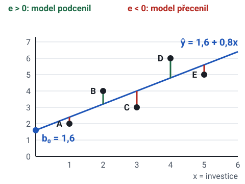
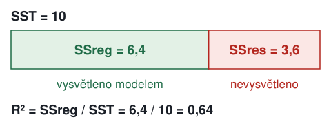
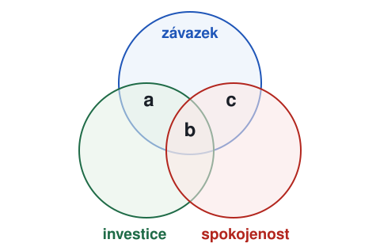
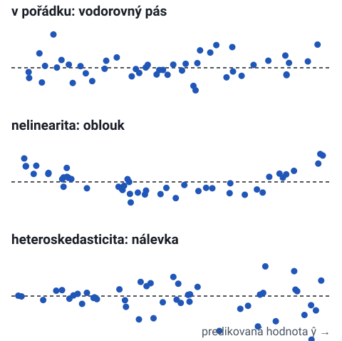
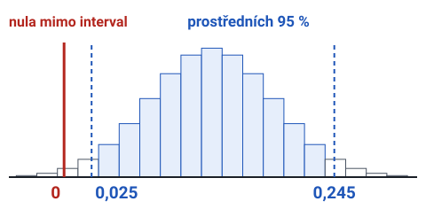
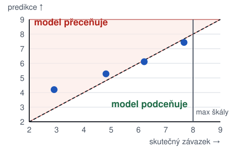

# Lineární regrese v JASP: průvodce k úkolům 5 a 6

Průvodce vychází ze zadání cvičení 2 předmětu PSYb2521. Výzkumná otázka zní, zda závazek ve vztahu souvisí pozitivně s investicemi a spokojeností a negativně s alternativami i po kontrole délky vztahu. Data ze zadání v průvodci nejsou. Všechna čísla pocházejí z vymyšlených dat se stejnými proměnnami, takže se skutečné výsledky budou lišit.

## 0. Co úkoly požadují

Úkol 5:

1. Model 1: závislá proměnná `zavazok`, jediný prediktor `investicie`.
2. Model 2: k investicím se přidají `spokojnost`, `alternativy` a `cas_mesiace`.
3. Popsat, jak se změnil koeficient investic.
4. Zkontrolovat předpoklady: linearitu, normalitu reziduí, homoskedasticitu, multikolinearitu a odlehlé hodnoty.
5. Spustit bootstrap s 5000 opakováními, uvést 95% intervaly spolehlivosti a porovnat závěry.
6. Do textu: postup, zacházení s chybějícími daty, počet případů, R², adjR², F test a koeficienty B, SE, β, t, p pro oba modely.

Úkol 6:

1. Vysvětlit, proč je koeficient `cas_mesiace` tak malý, překódovat proměnnou a uvést nový koeficient.
2. Z grafu reziduí proti predikovaným hodnotám zjistit, u koho se model nejvíc mýlí a jestli závazek přeceňuje, nebo podceňuje.
3. Porovnat rozsah predikovaných hodnot s rozsahem naměřeného závazku a říct, k čemu se model hodí.

## 1. Proměnné v úloze

| Proměnná | Role | Očekávaný směr |
|---|---|---|
| `zavazok` | závislá proměnná (kritérium) | |
| `investicie` | prediktor | kladný |
| `spokojnost` | prediktor | kladný |
| `alternativy` | prediktor | záporný |
| `cas_mesiace` | kontrolní proměnná, délka vztahu v měsících | kladný |

==Kontrolní proměnná== je prediktor jako každý jiný. Rozdíl je jen v tom, proč je v modelu. Výzkumníka nezajímá sama o sobě, ale chce, aby koeficienty ostatních prediktorů platily pro lidi se stejnou délkou vztahu.

Investiční model Caryl Rusbultové říká, že závazek tvoří tři složky: spokojenost, investice a kvalita alternativ. Délka vztahu do modelu teoreticky nepatří a přidává se, protože závazek může s časem růst sám.

> Shrnutí
> - Závislá proměnná je závazek. Investice, spokojenost a alternativy jsou prediktory z investičního modelu.
> - Délka vztahu je kontrolní proměnná. Je v modelu, aby ostatní koeficienty platily pro lidi se stejnou délkou vztahu.

## 2. Jednoduchá regrese od základů

### Přímka

Jednoduchá lineární regrese hledá přímku

**ŷ = b₀ + b₁ · x**

- ŷ je predikovaná hodnota závislé proměnné.
- b₀ je ==průsečík (intercept)==. Je to predikce pro x = 0.
- b₁ je ==sklon==. Říká, o kolik se změní ŷ, když x vzroste o jednu jednotku.
- ==Reziduum== e = y − ŷ je chyba predikce u jednoho člověka. **Kladné** reziduum znamená, že model člověka **podcenil**. **Záporné** reziduum znamená, že ho **přecenil**.

==Metoda nejmenších čtverců== vybere tu přímku, u které je součet čtverců reziduí Σe² nejmenší.

### Vzorce

- **b₁ = Sxy / Sxx**, kde Sxy = Σ(x − x̄)(y − ȳ) a Sxx = Σ(x − x̄)²
- **b₀ = ȳ − b₁ · x̄**
- SST = Σ(y − ȳ)² je celková variabilita y.
- SSres = Σe² je variabilita, kterou model nevysvětlil.
- SSreg = SST − SSres je variabilita, kterou model vysvětlil.
- **R² = SSreg / SST** je ==podíl vysvětleného rozptylu==.
- MSres = SSres / (n − k − 1), kde k je počet prediktorů. Odmocnina z MSres je směrodatná chyba odhadu (RMSE).
- SE(b₁) = √(MSres / Sxx)
- t = b₁ / SE(b₁) s n − k − 1 stupni volnosti
- F = (SSreg / k) / MSres se stupni volnosti k a n − k − 1

### Výpočet ručně na pěti lidech

Pět lidí, x = investice, y = závazek.

| Člověk | x | y | x − x̄ | y − ȳ | (x − x̄)(y − ȳ) | (x − x̄)² | (y − ȳ)² |
|---|---|---|---|---|---|---|---|
| A | 1 | 2 | −2 | −2 | 4 | 4 | 4 |
| B | 2 | 4 | −1 | 0 | 0 | 1 | 0 |
| C | 3 | 3 | 0 | −1 | 0 | 0 | 1 |
| D | 4 | 6 | 1 | 2 | 2 | 1 | 4 |
| E | 5 | 5 | 2 | 1 | 2 | 4 | 1 |
| Součet | 15 | 20 | | | Sxy = 8 | Sxx = 10 | SST = 10 |

Průměry jsou x̄ = 3 a ȳ = 4.

- b₁ = 8 / 10 = 0,8. Každý bod investic navíc znamená o 0,8 bodu vyšší predikovaný závazek.
- b₀ = 4 − 0,8 · 3 = 1,6. Rovnice je ŷ = 1,6 + 0,8 · x.
Predikce a rezidua:

| Člověk | y | ŷ | e = y − ŷ | e² |
|---|---|---|---|---|
| A | 2 | 2,4 | −0,4 | 0,16 |
| B | 4 | 3,2 | 0,8 | 0,64 |
| C | 3 | 4,0 | −1,0 | 1,00 |
| D | 6 | 4,8 | 1,2 | 1,44 |
| E | 5 | 5,6 | −0,6 | 0,36 |
| Součet | | | 0 | SSres = 3,6 |

- SSreg = 10 − 3,6 = 6,4 a **R² = 6,4 / 10 = 0,64**. Model vysvětluje 64 % rozptylu závazku.
- adjR² = 1 − (1 − R²)(n − 1)/(n − k − 1) = 1 − 0,36 · 4/3 = 0,52.
- MSres = 3,6 / (5 − 1 − 1) = 1,2 a SE(b₁) = √(1,2 / 10) = 0,346.
- t = 0,8 / 0,346 = 2,31 při df = 3. Kritická hodnota t₀,₉₇₅;₃ = 3,18 a p = 0,104. Sklon není na hladině 0,05 statisticky významný.
- F = 6,4 / 1,2 = 5,33 se stupni volnosti (1, 3) a p = 0,104. U jednoho prediktoru platí F = t², protože 2,31² = 5,33.

> Pozor
> Na pěti lidech vyšlo R² = 0,64, a přesto je výsledek nevýznamný. Velikost efektu a statistická významnost jsou dvě různé věci. Významnost závisí na velikosti vzorku.

### Standardizovaný koeficient β

**β = b₁ · sₓ / s_y**

β je ==sklon v jednotkách směrodatných odchylek==. Říká, o kolik směrodatných odchylek se změní predikce y, když x vzroste o jednu směrodatnou odchylku. V příkladu je sₓ = s_y = √(10/4) = 1,58, takže β = 0,8. U jednoho prediktoru se β rovná Pearsonovu r.

> Shrnutí
> - Přímka ŷ = b₀ + b₁x minimalizuje součet čtverců reziduí.
> - b₁ říká, o kolik se změní predikce při změně x o jednotku. b₀ je predikce pro x = 0.
> - R² je podíl vysvětleného rozptylu SSreg / SST.
> - Velké R² v malém vzorku nemusí být významné. U jednoho prediktoru platí F = t².
> - β je sklon ve směrodatných odchylkách a u jednoho prediktoru se rovná r.

## 3. Vícenásobná regrese

ŷ = b₀ + b₁x₁ + b₂x₂ + … + b_k x_k

Každý koeficient b_j říká, o kolik se změní predikce, když x_j vzroste o jednotku a ostatní prediktory zůstanou stejné. Proto se ve větě o výsledku píše **„při kontrole ostatních proměnných“**.

### Proč se koeficient investic změní

V modelu 1 je jen investice. Lidé s vysokými investicemi bývají zároveň spokojenější, a spokojenost závazek silně zvyšuje. Koeficient investic v modelu 1 proto obsahuje i část vlivu spokojenosti. Po přidání spokojenosti do modelu zbude investicím jen ta část vztahu se závazkem, kterou ==nesdílejí s ostatními prediktory==. Koeficient se zmenší.

Koeficient se změní tím víc, čím silněji nový prediktor koreluje s původním prediktorem a se závislou proměnnou. Pokud by spokojenost s investicemi nekorelovala, koeficient investic by se po jejím přidání nezměnil.

### R², adjR² a F test

- R² v modelu s více prediktory nikdy neklesne, ani když přidaný prediktor nic nevysvětluje.
- adjR² = 1 − (1 − R²)(n − 1)/(n − k − 1) penalizuje počet prediktorů. Při porovnání modelů s různým počtem prediktorů se dívá na **adjR²**.
- F test modelu testuje H0, že všechny koeficienty kromě interceptu jsou nulové. Významné F znamená, že model jako celek vysvětluje víc než samotný průměr.
- t test koeficientu testuje H0: β_j = 0 pro jeden prediktor při kontrole ostatních.

### β ve vícenásobné regresi

β umožňuje porovnat prediktory měřené v různých jednotkách. Prediktor s větší absolutní hodnotou β má v modelu silnější jedinečný vztah k závislé proměnné. Nestandardizované B se mezi prediktory porovnávat nedá, protože závisí na jednotkách.

> Shrnutí
> - Koeficient b_j platí při kontrole ostatních prediktorů.
> - Koeficient investic klesne, když se přidá prediktor, se kterým investice sdílejí vztah k závazku.
> - R² po přidání prediktoru neklesne. Modely s různým počtem prediktorů se porovnávají podle adjR².
> - F test hodnotí celý model, t test jeden koeficient. Prediktory se porovnávají podle β, ne podle B.

## 4. Postup v JASP

Názvy voleb jsou z anglického rozhraní JASP. V jiné verzi mohou být v jiné sekci.

1. Regression → Linear Regression (klasická, ne Bayesian).
2. Dependent Variable: `zavazok`. Covariates: `investicie`. Method: Enter.
3. Statistics: Estimates, Confidence intervals (95 %), Model fit, Descriptives, Collinearity diagnostics, Casewise diagnostics.
4. Plots: Residuals vs. predicted, Q-Q plot standardized residuals, případně histogram reziduí.
5. Model 2 je druhá analýza, která má v Covariates navíc `spokojnost`, `alternativy` a `cas_mesiace`. Druhá možnost je jedna analýza se všemi prediktory, ve které se investice v sekci Model označí jako součást nulového modelu. JASP pak ukáže oba modely a změnu R² (volba R squared change).
6. Bootstrap: v Statistics u regresních koeficientů zaškrtnout bootstrap a nastavit 5000 opakování.

### Chybějící data

JASP v lineární regresi standardně vyřadí každý případ, kterému chybí hodnota v kterékoli proměnné analýzy (==listwise deletion==). Nastavení je v sekci Options u Missing Values.

V ukázkových datech je 184 lidí. Model 1 ve vlastní analýze použije 179 lidí, protože vyřadí jen ty, kterým chybí závazek nebo investice. Model 2 použije 170 lidí, protože chybějící hodnoty má víc proměnných. 
> Pozor
> Oba modely pak stojí na různých lidech a změna koeficientu může být zčásti způsobená jiným vzorkem. Jedna analýza s nulovým modelem počítá oba modely na **stejných 170 lidech**.

 Ve zprávě se uvádí, kolik případů každý model použil a jak JASP chybějící hodnoty řešil.

Počet případů v modelu se dá přečíst z tabulky Descriptives nebo ze stupňů volnosti: **N = df_res + k + 1**. Celkový df v tabulce ANOVA je N − 1.

> Shrnutí
> - Model 1 má jen investice, model 2 všechny čtyři prediktory. Metoda je Enter.
> - Bootstrap se zapíná u koeficientů a má 5000 opakování.
> - Chybějící data JASP řeší vyřazením celého případu. Oba modely mají počítat se stejnými lidmi.

## 5. Ukázkové výsledky

Oba modely jsou spočítané na stejných 170 lidech. Zobrazené hodnoty jsou zaokrouhlené.

### Model 1

| Statistika | Hodnota |
|---|---|
| N | 170 |
| R² | 0,333 |
| adjR² | 0,329 |
| F | F(1, 168) = 83,96, p < 0,001 |

| | B | SE | β | t | p |
|---|---|---|---|---|---|
| (Intercept) | 4,116 | 0,270 | | 15,24 | < 0,001 |
| investicie | 0,541 | 0,059 | 0,577 | 9,16 | < 0,001 |

### Model 2

| Statistika | Hodnota |
|---|---|
| N | 170 |
| R² | 0,728 |
| adjR² | 0,722 |
| F | F(4, 165) = 110,65, p < 0,001 |

| | B | SE | β | t | p | VIF |
|---|---|---|---|---|---|---|
| (Intercept) | 3,527 | 0,357 | | 9,87 | < 0,001 | |
| investicie | 0,134 | 0,052 | 0,143 | 2,58 | 0,011 | 1,86 |
| spokojnost | 0,565 | 0,056 | 0,600 | 10,11 | < 0,001 | 2,14 |
| alternativy | −0,232 | 0,041 | −0,264 | −5,63 | < 0,001 | 1,34 |
| cas_mesiace | 0,0025 | 0,0019 | 0,058 | 1,29 | 0,198 | 1,22 |

### Jak čísla číst

- Model 1: s každým bodem investic roste predikovaný závazek o 0,54 bodu. Investice samy vysvětlují 33 % rozptylu závazku.
- Model 2 vysvětluje 73 % rozptylu. adjR² vzrostlo z 0,329 na 0,722, takže přidané prediktory nejsou jen šum.
- Koeficient investic klesl z **0,541 na 0,134** a β z **0,577 na 0,143**. Investice korelují se spokojeností (r = 0,59) a velká část jejich vztahu k závazku byla ve skutečnosti vztah spokojenosti. Při kontrole ostatních proměnných zůstává malý, ale významný kladný vztah.
- Nejsilnějším prediktorem je ==spokojenost== (β = 0,60). Alternativy mají podle očekávání záporný koeficient (β = −0,26).
- Délka vztahu při kontrole složek investičního modelu se závazkem významně nesouvisí (p = 0,198).
- Intercept 3,527 je predikce pro člověka s nulou ve všech prediktorech a vztahem dlouhým 0 měsíců. Takový člověk v datech není, takže se intercept neinterpretuje.

### Ukázka zápisu

> Do zprávy
> Analýza: „Byly spočítány dva lineární regresní modely metodou Enter se závazkem jako závislou proměnnou. Model 1 obsahoval jen investice, model 2 navíc spokojenost, alternativy a délku vztahu v měsících. Případy s chybějící hodnotou v kterékoli proměnné byly vyřazeny (listwise). Koeficienty byly ověřeny bootstrapem s 5000 opakováními a 95% intervaly spolehlivosti.“

> Do zprávy
> Výsledky: „Model 1 (N = 170) vysvětlil 33 % rozptylu závazku, R² = 0,33, adjR² = 0,33, F(1, 168) = 83,96, p < 0,001. Investice závazek predikovaly kladně, B = 0,54, SE = 0,06, β = 0,58, t = 9,16, p < 0,001. Model 2 vysvětlil 73 % rozptylu, R² = 0,73, adjR² = 0,72, F(4, 165) = 110,65, p < 0,001. Po přidání dalších prediktorů klesl koeficient investic na B = 0,13, SE = 0,05, β = 0,14, t = 2,58, p = 0,011.“

> Pozor
> V JASP se místo desetinné čárky zobrazuje tečka. Ve zprávě v češtině se píše čárka.

> Shrnutí
> - Přidání spokojenosti, alternativ a délky vztahu zvýšilo R² z 0,33 na 0,73.
> - Koeficient investic klesl na čtvrtinu, ale zůstal kladný a významný.
> - Nejsilnější je spokojenost, alternativy mají záporný koeficient a délka vztahu není významná.
> - Intercept se neinterpretuje, protože člověk s nulou ve všech prediktorech v datech není.

## 6. Předpoklady regresního modelu

| Předpoklad | Kde se kontroluje | Co je v pořádku | Co znamená porušení |
|---|---|---|---|
| Linearita | graf reziduí proti predikovaným hodnotám, parciální grafy | body tvoří vodorovný pás kolem nuly bez oblouku | koeficienty popisují vztah špatně, model systematicky chybuje v části rozsahu |
| Normalita reziduí | Q-Q graf standardizovaných reziduí, histogram reziduí | body leží blízko diagonály | p hodnoty a intervaly spolehlivosti nemusí sedět, hlavně v malém vzorku |
| Homoskedasticita | graf reziduí proti predikovaným hodnotám | rozptyl reziduí je všude stejný | směrodatné chyby, p hodnoty a intervaly jsou nepřesné |
| Multikolinearita | VIF a tolerance (Collinearity diagnostics) | VIF blízko 1 | velké SE, nestabilní koeficienty, které se mění s malou změnou dat |
| Odlehlé a vlivné hodnoty | Casewise diagnostics, Cookova vzdálenost | žádné standardizované reziduum nad 3, Cookova vzdálenost pod 1 | jeden člověk může přetáhnout přímku |

> Pozor
> Normalita se týká **reziduí**, ne samotných proměnných. Šikmá závislá proměnná nevadí, pokud jsou rezidua přibližně normální.

Tolerance je 1 / VIF. VIF nad 5 se obvykle bere jako varování a nad 10 jako vážný problém. Hranice se mezi učebnicemi liší, takže je lepší použít tu, kterou uvádí přednáška.

Porušení homoskedasticity a normality **koeficienty B nezkresluje**. Nepřesné jsou směrodatné chyby, a tím i t, p a intervaly spolehlivosti. **Nelinearitu ani vlivné body bootstrap neopraví.**

### Předpoklady v ukázkových datech

- Linearita: v grafu reziduí není oblouk.
- Normalita reziduí: Q-Q graf je téměř na diagonále. Závazek je sešikmený doleva (šikmost −0,97), ale rezidua jsou přibližně symetrická.
- Homoskedasticita: rozptyl reziduí se u vysokých predikcí zužuje. Směrodatná odchylka reziduí je v dolní třetině predikcí 0,80, ve střední 0,78 a v horní 0,52. Příčinou je strop škály, protože 41 ze 170 lidí má maximální závazek 8 a jejich skutečná hodnota nemůže být vyšší.
- Multikolinearita: všechny VIF jsou pod 2,2, takže problém není.
- Odlehlé hodnoty: největší standardizované reziduum má absolutní hodnotu 2,60 a největší Cookova vzdálenost je 0,07. Žádný případ hranice nepřekračuje.

Omezení plynoucí z porušené homoskedasticity: klasické SE mohou být podhodnocené nebo nadhodnocené, takže p hodnoty je třeba brát s rezervou. Bootstrap ukáže, jestli se tím mění závěry.

> Shrnutí
> - Linearita a homoskedasticita se čtou z grafu reziduí proti predikcím, normalita z Q-Q grafu reziduí.
> - Multikolinearitu ukáže VIF, odlehlé hodnoty standardizovaná rezidua a Cookova vzdálenost.
> - V ukázkových datech je porušená jen homoskedasticita, kvůli stropu škály u vysokých predikcí.

## 7. Bootstrap

Bootstrap nepotřebuje předpoklad normality reziduí ani stejného rozptylu. Postup:

1. Z dat se náhodně vybere stejný počet lidí s vracením. Někdo je ve výběru dvakrát, někdo vůbec.
2. Na tomto výběru se spočítá regrese a uloží se koeficienty.
3. Kroky 1 a 2 se zopakují 5000krát.
4. 95% interval spolehlivosti je rozsah, ve kterém leží ==prostředních 95 %== z 5000 koeficientů. U percentilového intervalu jsou hranice 2,5. a 97,5. percentil.

Pokud 95% interval **neobsahuje nulu**, je koeficient významný na hladině 0,05. Pokud nulu obsahuje, významný není. Výsledky se mezi spuštěními mírně liší, protože výběry jsou náhodné. JASP může počítat jiný typ intervalu než percentilový a hranice se pak trochu liší.

### Bootstrap v ukázkových datech (model 2)

| | B | klasický 95% CI | bootstrap SE | bootstrap 95% CI |
|---|---|---|---|---|
| investicie | 0,134 | 0,032 až 0,236 | 0,056 | 0,025 až 0,245 |
| spokojnost | 0,565 | 0,455 až 0,675 | 0,054 | 0,455 až 0,667 |
| alternativy | −0,232 | −0,313 až −0,150 | 0,038 | −0,308 až −0,160 |
| cas_mesiace | 0,0025 | −0,0013 až 0,0062 | 0,0018 | −0,0014 až 0,0059 |

Bootstrap SE investic (0,056) je o něco větší než klasické SE (0,052) a interval je širší. Žádný interval ale nezměnil, jestli obsahuje nulu. Investice, spokojenost a alternativy zůstávají významné a délka vztahu zůstává nevýznamná.

> Shrnutí
> - Bootstrap opakuje výběr s vracením 5000krát a interval tvoří prostředních 95 % koeficientů.
> - Interval bez nuly znamená významný koeficient na hladině 0,05.
> - V ukázkových datech bootstrap žádný závěr nezměnil.

## 8. Úkol 6: překódování délky vztahu

### Proč je koeficient malý

B říká, o kolik se změní závazek při změně prediktoru o jednu jednotku. Jednotkou je jeden měsíc. Jeden měsíc vztahu navíc závazek prakticky nezmění, takže B = 0,0025. 
> Pozor
> Malé B neznamená slabý vztah. Síla vztahu se pozná z **β a z t**, které na jednotkách nezávisí.

### Překódování

Nejjednodušší je převést měsíce na roky: `cas_roky = cas_mesiace / 12`. V JASP se to udělá novou vypočítanou proměnnou (tlačítko + vedle posledního sloupce v datech, typ Computed) se vzorcem `cas_mesiace / 12`. Nová proměnná pak v modelu nahradí `cas_mesiace`.

Co se změní:

- B i SE se **vynásobí 12**: B = 0,030, SE = 0,023. Rok vztahu navíc znamená o 0,03 bodu vyšší predikovaný závazek.
- β, t, p, R² a koeficienty ostatních prediktorů **zůstanou stejné**, protože se změnila jen jednotka, ve které se vztah vyjadřuje.

Jiné rozumné jednotky jsou například 6 měsíců. Je možné proměnnou i vycentrovat (odečíst průměr), pak intercept znamená predikci pro člověka s průměrnou délkou vztahu.

### Kde se model mýlí

Graf Residuals vs. predicted má na ose x predikovaný závazek a na ose y reziduum. Reziduum je skutečná hodnota minus predikce.

V ukázkových datech:

| Skutečný závazek | Počet lidí | Průměrná predikce | Průměrné reziduum |
|---|---|---|---|
| pod 4 | 9 | 4,20 | −1,29 |
| 4 až 5,4 | 26 | 5,28 | −0,47 |
| 5,5 až 6,9 | 61 | 6,11 | 0,10 |
| 7 až 8 | 74 | 7,43 | 0,24 |

- Model se nejvíc mýlí u lidí s **nízkým závazkem**. Jejich rezidua jsou záporná, takže model jejich závazek přeceňuje, průměrně o 1,3 bodu.
- U lidí s vysokým závazkem model závazek mírně podceňuje.
- Predikce jsou ==stažené k průměru==. Tak se chová každý model s R² menším než 1, protože směrodatná odchylka predikcí je √R² krát směrodatná odchylka y.

### Rozsah predikcí

- Naměřený závazek je od 1,8 do 8,0.
- Predikovaný závazek je od 3,39 do 9,21. U 20 lidí model predikuje víc než 8, což na škále 0 až 8 nejde.
- Nejnižší predikce 3,39 je vysoko nad nejnižším naměřeným závazkem. Velmi nízký závazek by model nikomu nepředpověděl.

### K čemu se model hodí

Model se hodí k vysvětlení, tedy k ověření teorie: které složky se závazkem souvisejí, jakým směrem a jak silně při kontrole ostatních. Na úrovni skupiny ukazuje, že spokojenost a alternativy jsou se závazkem spojené víc než investice a délka vztahu.

Model se nehodí k predikci u jednotlivce, například k odhadu, kdo z páru odejde. RMSE je 0,74 bodu, predikce jsou stažené k průměru a lidi s nízkým závazkem model systematicky přeceňuje. Přednáška může účely modelování pojmenovat jinak a ve zprávě je lepší použít její pojmy.

> Shrnutí
> - Převod měsíců na roky vynásobí B a SE dvanácti. β, t, p a R² se nezmění.
> - Model přeceňuje lidi s nízkým závazkem a predikce jsou stažené k průměru.
> - Model se hodí k vysvětlení vztahů ve skupině, ne k predikci u jednotlivce.

## 9. Kontrolní seznam před odevzdáním

1. Oba modely mají uvedené N a je řečeno, jak JASP naložil s chybějícími daty.
2. U obou modelů je R², adjR² a F se stupni volnosti a p.
3. U každého koeficientu je B, SE, β, t a p.
4. Je popsaná změna koeficientu investic a vysvětlená sdíleným rozptylem se spokojeností.
5. U každého z pěti předpokladů je uvedeno, čím se kontroloval, co vyšlo a jaké z toho plyne omezení.
6. Je uveden bootstrap s 5000 opakováními, 95% intervaly a jestli se změnily závěry.
7. U úkolu 6 je nová jednotka délky vztahu, nové B s interpretací, popis grafu reziduí a rozsah predikcí proti rozsahu dat.
8. Soubory jsou pojmenované podle zadání, například SS_1_SK9_U2.docx a SS_1_SK9_U2.jasp.
